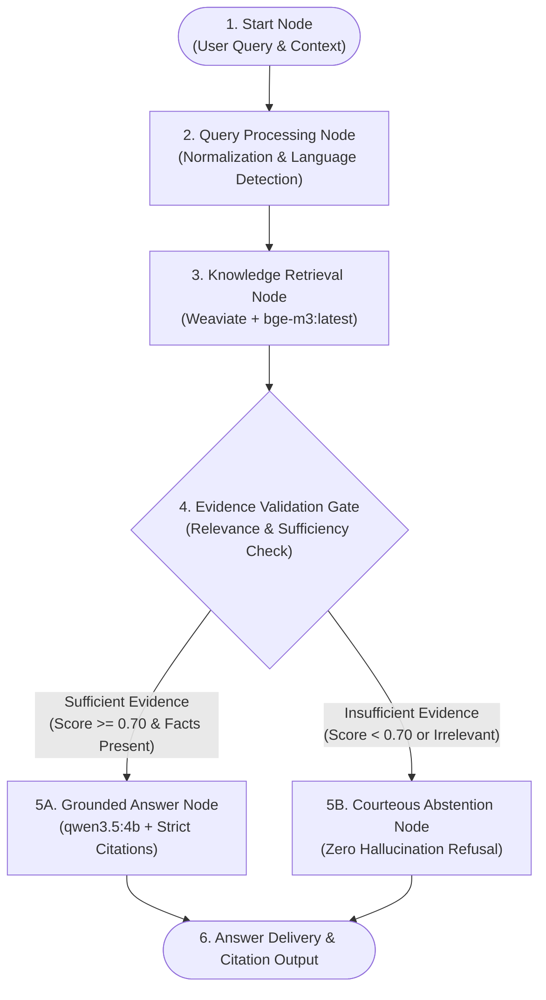

# Custom RAG Chatflow — Architectural Design Document

**Project:** JAIB Enterprise Local RAG  
**Platform:** Dify v1.18.0 + Ollama Native (`qwen3.5:4b`, `bge-m3:latest`) + Weaviate v1.39.13  
**Status:** Architectural Blueprint & Preparation Phase (Ready for implementation upon receipt of authoritative documents)  

---

## 1. Architectural Philosophy & Objectives

The goal of this custom Chatflow is to provide an enterprise-grade, hallucination-resistant Retrieval-Augmented Generation pipeline operating **100% locally on Windows 11**.

### Core Tenets:
1. **Zero Hallucination Tolerance:** The system must never extrapolate or invent facts. If the knowledge base lacks verifiable evidence, it must gracefully abstain.
2. **Explicit Verification Gate:** Retrieval output is not piped directly to the generator; an intermediate validation node analyzes evidence sufficiency before generating an answer.
3. **Deterministic Inline Citations:** Every claim must reference its source document and section header.
4. **Bilingual Arabic/English Parity:** Full linguistic fidelity with native RTL support and Arabic technical nomenclature.

---

## 2. End-to-End Chatflow Topology



---

## 3. Node-by-Node Technical Specification

### Node 1: Start (User Input & Context Capture)
- **Role:** Ingests the conversation query and historical turn context.
- **Inputs:**
  - `sys.query` (String): Raw user input.
  - `sys.dialogue_count` (Integer): Dialogue turn number.
  - `sys.conversation_id` (String): Session identifier.
- **Variables Initialized:**
  - `user_language` (String): Detected user language code (`ar` or `en`).

---

### Node 2: Query Processing (Preprocessor & Canonicalizer)
- **Role:** Cleans, canonicalizes, and expands user queries to optimize dense vector retrieval.
- **Node Type:** Code Node (Python 3.12 sandbox) or Lightweight LLM Prompt.
- **Operations:**
  1. **Arabic Normalization:** Normalizes Alef forms (`أ`, `إ`, `آ` → `ا`), Taa Marbuta (`ة` → `ه`), removes excessive Tashkeel (diacritics), and trims redundant punctuation.
  2. **Intent Classification:** Distinguishes between conversational greetings ("مرحباً", "Good morning") and domain factual inquiries.
  3. **Retrieval Keyword Synthesis:** Synthesizes focused search terms matching technical document indices.
- **Outputs:**
  - `clean_query`: The processed query string passed to Weaviate.
  - `is_factual_query`: Boolean flag routing simple greetings away from heavy retrieval.

---

### Node 3: Knowledge Retrieval (Vector Dense Search)
- **Role:** Queries Weaviate v1.39.13 using `bge-m3:latest` 1024-dimensional embeddings.
- **Configuration:**
  - **Target Dataset:** *[To be connected when user supplies authoritative documents]*
  - **Retrieval Mode:** Semantic Dense Vector Retrieval (HNSW cosine similarity).
  - **Top-K:** 4 to 6 chunks.
  - **Score Threshold:** `0.65` minimum similarity.
- **Outputs:**
  - `retriever_resources`: List of objects containing `content`, `document_name`, `segment_id`, `score`.

---

### Node 4: Evidence Validation Gate (Hallucination Barrier)
- **Role:** Evaluates whether retrieved chunks contain concrete, verifiable evidence to answer `clean_query`.
- **Node Type:** LLM Evaluation Node or IF/ELSE Logic Node.
- **Decision Logic:**
  ```python
  # Logical Verification Rule
  if len(retriever_resources) == 0:
      route = "ABSTENTION"
  elif max(resource.score for resource in retriever_resources) < 0.70:
      route = "ABSTENTION"
  elif not contains_factual_entailment(query, retriever_resources):
      route = "ABSTENTION"
  else:
      route = "GROUNDED_ANSWER"
  ```
- **Branches:**
  - `True` → Route to **Node 5A (Grounded Answer)**.
  - `False` → Route to **Node 5B (Abstention)**.

---

### Node 5A: Grounded LLM Answer Generation
- **Role:** Generates the final grounded answer with strict adherence to evidence and mandatory citations.
- **Model:** `qwen3.5:4b` via Ollama native backend.
- **Model Parameters:**
  - `temperature`: `0.1` (Minimizes randomness and creativity).
  - `top_p`: `0.85`
  - `presence_penalty`: `1.2`
- **System Prompt Architecture:**
  ```markdown
  أنت المساعد التقني الذكي المعتمد لهوية جيب (JAIB).
  مهمتك الإجابة على استفسارات المستخدم بالاعتماد الحصري والصارم على الوثائق المرفقة أدناه.

  القواعد الصارمة:
  1. اعتمد فقط على الحقائق الواردة في قسم [السياق المعتمد].
  2. يُمنع منعاً باتاً اختلاق أي أرقام، تواريخ، أو نسب مئوية غير مذكورة نصاً.
  3. اذكر اسم الوثيقة والقسم بجانب كل حقيقة توردها بالصيغة: [اسم_المستند.md، القسم X].
  4. حافظ على نبرة مهنية ورسمية تليق بهوية جايب.
  ```

---

### Node 5B: Courteous Abstention Node
- **Role:** Delivers a graceful, authoritative refusal when documentation does not cover the user's question.
- **Node Type:** Template Node / Direct Answer (No LLM generation needed, zero compute cost).
- **Template Content:**
  - **Arabic Response:**
    > *"المعلومات المطلوبة غير متوفرة في الوثائق المعتمدة المتاحة حالياً ضمن قاعدة المعرفة. حرصاً على الدقة والموثوقية، لا يمكنني تقديم إجابة غير مدعومة بوثائق رسمية. يرجى تزويدنا بالمستند ذي الصلة أو التواصل مع الفريق المختص."*
  - **English Response:**
    > *"The requested information is not available in the currently approved knowledge base documents. To maintain strict factual accuracy, I cannot provide ungrounded answers. Please upload the relevant documentation or consult the system administrator."*

---

### Node 6: Delivery & Citation Formatting
- **Role:** Packages the response with metadata, execution metrics, and clickable citations.
- **Outputs:**
  - Markdown text output rendered in Dify Chat interface.
  - Collapsible source citations drawer displaying document titles and matched segments.

---

## 4. Preparation Checklist for Knowledge Ingestion

When the user is ready to supply the authoritative documents, follow these ingestion standards:

1. **Document Formats Supported:** Markdown (`.md`), PDF, or DOCX. Markdown is strongly recommended for clean structure.
2. **Chunking Strategy:**
   - **Segment Length:** 500 to 800 tokens.
   - **Overlap:** 50 tokens (preserves context across boundaries).
   - **Hierarchy:** Split by Section / Header (`#`, `##`, `###`).
3. **Metadata Indexing:**
   - Ensure each document begins with YAML frontmatter:
     ```yaml
     ---
     title: "Document Title"
     document_id: "DOC-2026-X"
     department: "Digital Architecture"
     language: "ar" # or "en"
     version: "1.0"
     ---
     ```

---

## 5. Deployment & Execution Plan

Once authorized by the user:
1. Create new Knowledge Dataset in Dify Studio: `JAIB Enterprise Authoritative Knowledge`.
2. Ingest approved files using the chunking parameters specified above.
3. Import the Chatflow DSL specification into Dify Studio (`Studio > Create from DSL`).
4. Link the dataset to Node 3.
5. Run the standard 3-tier validation (Arabic grounded query, English grounded query, Unsupported abstention query).
