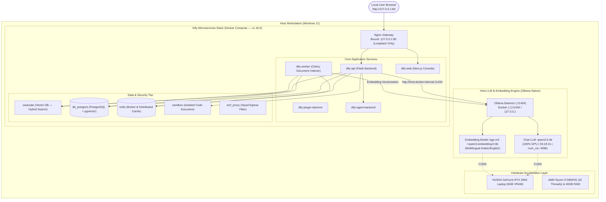

# Local RAG Platform — Dify 1.18.0 & Ollama Native

[](https://github.com/langgenius/dify/releases/tag/1.18.0)
[](https://ollama.com)
[-76B900.svg)](https://www.nvidia.com)
[](#bilingual-rag-support)
[](docs/security/security-policy.md)
[](LICENSE)

An enterprise-grade, fully local **Retrieval-Augmented Generation (RAG)** platform designed for high-precision document question-answering in **Arabic and English**. 

The system couples **Dify Open Source (Pinned v1.18.0)** as the workflow orchestrator and web UI with **Ollama** running natively on the host workstation to deliver 100% GPU-accelerated inference without routing documents, embeddings, or prompts through external cloud APIs.

---

## نبذة تنفيذية للمشروع (Executive Overview in Arabic)

يهدف هذا المشروع إلى بناء وتشغيل نظام **استرجاع وتوليد معزز (RAG)** محلي بالكامل وعالي الأمان على جهاز الحاسوب الشخصي، مع التركيز على:
1. **السيادة التامة على البيانات (Zero Cloud Dependence):** تشغيل جميع نماذج المحادثة ونماذج التضمين الشعاعي محلياً بنسبة 100% دون أي اتصال بخدمات الذكاء الاصطناعي السحابية المدفوعة.
2. **الدعم المتقدم للوثائق العربية والإنجليزية:** استخراج وفهرسة دقيقة لنصوص الوثائق (PDF, Word, Markdown, TXT) ودعم البحث الدلالي العابر للغات (طرح سؤال بالعربية واسترجاع إجابة موثقة من وثائق إنجليزية).
3. **التسريع العتادي الأقصى (GPU Acceleration):** تفريغ كامل لنموذج التوليد `qwen3.5:4b` على كرت الشاشة `NVIDIA RTX 3060 6GB` محققاً سرعة توليد مقاسة بلغت **59.18 كلمة/ثانية**.
4. **التوثيق الصارم ومنع الهلوسة:** إلزام النموذج بحصر إجاباته في السياق المسترجع فقط مع ذكر اسم الوثيقة ورقم الفقرة، والامتناع الصريح عن الإجابة في حال عدم توفر المعلومة.
5. **العزل الأمني الصارم:** حصر الوصول لواجهة النظام وقواعد البيانات على حلقة الاسترجاع المحلية (`127.0.0.1`) وحماية المنافذ من أي كشف على الشبكة المحلية أو الإنترنت.

---

## Architecture Topology

The platform deploys Dify v1.18.0's official multi-container architecture inside Docker Compose, connected via an internal bridge to Ollama running natively on the host:



---

## Measured Hardware Benchmarks

Direct physical measurements captured on the workstation:

| Benchmark Parameter | Measured Result | Verification Detail |
| :--- | :--- | :--- |
| **Processor (CPU)** | AMD Ryzen 9 5900HS | 8 Cores / 16 Logical Processors, Zen 3 |
| **System Memory (RAM)** | 39.41 GB Total (~25.15 GB available) | Excess capacity for Dify multi-container stack (~4–5 GB) |
| **Graphics Processor (GPU)** | NVIDIA GeForce RTX 3060 Laptop GPU | 6144 MiB GDDR6 VRAM, Driver 621.01, CUDA 13.5 |
| **Chat LLM Model** | `qwen3.5:4b` | GGUF Q4_K_M (3.1 GB memory image) |
| **Context Window Tested** | `num_ctx: 4096` tokens | Conservative baseline ensuring 1650 MiB VRAM margin |
| **Execution Acceleration** | **100% GPU Offload** | Confirmed via `ollama ps` CUDA llamacpp runner |
| **Model Load Time** | **7.28 seconds** | Instantaneous model warmup |
| **Generation Speed** | **59.18 tokens/second** | 1969 tokens generated in 33.27 seconds |
| **Active VRAM Usage** | **4345 MiB / 6144 MiB** | 70.7% GPU memory utilization under peak load |

---

## Repository Structure

```
local-rag-dify/
├── README.md                      # Project documentation and architectural overview
├── CHANGELOG.md                   # Semantic versioning changelog
├── .gitignore                     # Comprehensive security and secret exclusion policy
├── .gitattributes                 # Cross-platform line ending normalization
├── .env.example                   # Hardened configuration template with Dify 1.18.0 tokens
├── docs/
│   ├── architecture/
│   │   └── system-architecture.md # Full 10-tier microservices architectural specification
│   ├── deployment/
│   │   ├── implementation-roadmap.md # Phased implementation protocol (Stages 0 to E)
│   │   └── git-workflow.md        # Conventional Commits and remote sync protocol
│   ├── security/
│   │   └── security-policy.md     # Public repo content protection and loopback rules
│   └── assessments/
│       ├── hardware-profile.md    # Sanitized hardware benchmarks and memory budgeting
│       └── private/               # (Gitignored) Raw machine-specific diagnostic reports
├── config/                        # Service-specific configuration templates
├── docker/                        # Pinned Docker Compose deployment files
├── scripts/                       # Operational management and automation scripts
├── tests/
│   ├── integration/               # Container health and loopback connectivity tests
│   └── rag-evaluation/            # Bilingual Arabic & English RAG quality benchmarks
├── prompts/                       # Hardened system prompts enforcing citation & abstention
└── workflows/                     # Dify DSL workflow export definitions
```

---

## Phased Implementation Roadmap

This project adheres to an isolated phased deployment protocol requiring explicit validation before moving to the next gate:

- [x] **Stage 0: GitHub Integration & Project Initialization** *(Completed)*
  - Remote repository setup, directory scaffolding, security exclusions, and public documentation.
- [ ] **Stage A: WSL2 and Docker Desktop Prerequisites** *(Pending Authorization)*
  - Enabling WSL2 Linux kernel and installing Docker Desktop with WSL2 backend.
- [ ] **Stage B: Dify 1.18.0 Deployment & Container Health Check**
  - Pinned stable release checkout, secret generation, loopback binding, and service verification.
- [ ] **Stage C: Ollama Networking & Embedding Model Configuration**
  - Host gateway connectivity verification, `bge-m3` benchmarking, and memory sizing.
- [ ] **Stage D: Knowledge Base Indexing & Bilingual RAG Application**
  - Document ingestion, semantic chunking (600 tokens / 10% overlap), and hybrid search tuning.
- [ ] **Stage E: Functional, Security & Performance Acceptance Testing**
  - Evaluating bilingual retrieval accuracy, cross-lingual queries, anti-hallucination abstention, and offline isolation.

---

## Security & Confidentiality Policy

Because this repository is public, strict data-exclusion measures are enforced:
- **No Secrets or Credentials:** `.env` files, API keys, passwords, and tokens are strictly excluded via `.gitignore`.
- **Loopback Enforcement:** Nginx is bound strictly to `127.0.0.1:80`. No service is exposed to the local network (`0.0.0.0`).
- **Data Sovereignty:** Uploaded documents, vector database stores, and model weights are retained locally and never committed.
- **Sanitized Reports:** All machine-specific personal serials and paths are isolated from public Git tracking.

For complete security guidelines, see [docs/security/security-policy.md](docs/security/security-policy.md).

---

## License

This project configuration and documentation are licensed under the [Apache License 2.0](LICENSE).  
Upstream software (Dify, Ollama, Qwen, Weaviate) are subject to their respective open-source licenses.
