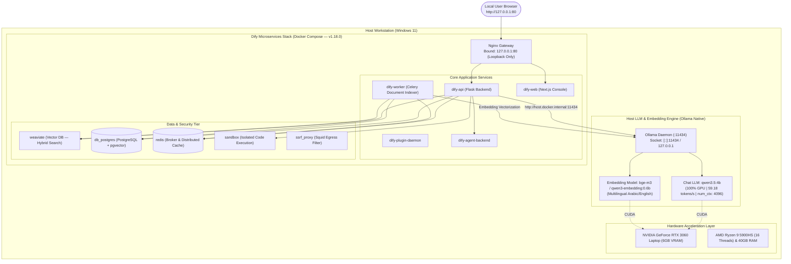

# Local RAG Platform — Dify 1.18.0 & Ollama Native

[](https://github.com/langgenius/dify/releases/tag/1.18.0)
[](#implementation-roadmap)
[](https://ollama.com)
[-76B900.svg)](https://www.nvidia.com)
[-0052FF.svg)](#jaib-wallet-visual-identity)
[](#bilingual-rag-support)
[](docs/security/security-policy.md)
[](LICENSE)

An enterprise-grade, self-hosted **Retrieval-Augmented Generation (RAG)** platform designed for high-precision document question-answering in **Arabic and English**. 

The system couples **Dify Open Source (Pinned v1.18.0)** as the workflow orchestrator and web UI with **Ollama** running natively on the host workstation to deliver 100% GPU-accelerated local inference without routing documents, embeddings, or prompts through external cloud APIs.

> [!NOTE]
> **Operational Network Scope:**
> The RAG inference runtime, vector indexing, and model execution are 100% self-hosted and offline-capable (no data or prompts ever leave the local machine). Standard internet connectivity is utilized strictly for developer administrative workflows: package installations, pulling official Docker images, and synchronizing code with the public GitHub repository.

---

## نبذة تنفيذية للمشروع (Executive Overview in Arabic)

يهدف هذا المشروع إلى بناء وتشغيل نظام **استرجاع وتوليد معزز (RAG)** ذاتي الاستضافة ومحلي المعالجة وعالي الأمان على جهاز الحاسوب الشخصي، مع التركيز على:
1. **السيادة التامة على البيانات والاستدلال المحلي (100% Local Inference):** تشغيل جميع نماذج المحادثة ونماذج التضمين الشعاعي محلياً بالكامل دون أي اتصال بخدمات الذكاء الاصطناعي السحابية الخارجية.
2. **الدعم المتقدم للوثائق العربية والإنجليزية:** استخراج وفهرسة دقيقة لنصوص الوثائق (PDF, Word, Markdown, TXT) ودعم البحث الدلالي العابر للغات (طرح سؤال بالعربية واسترجاع إجابة موثقة من وثائق إنجليزية).
3. **التسريع العتادي الأقصى (GPU Acceleration):** تفريغ كامل لنموذج التوليد `qwen3.5:4b` ونموذج التضمين `bge-m3:latest` على كرت الشاشة `NVIDIA GeForce RTX 4050 Laptop GPU (6GB VRAM)` محققاً كفاءة عالية واستجابة سريعة.
4. **الهوية البصرية الرسمية (جيب — Jaib Wallet):** دمج كامل للهوية البصرية لمحفظة جيب الرقمية (Jaib Wallet) في واجهة Dify Web عبر حزم Next.js المخصصة، متضمنة الشعار والألوان والخطوط والأيقونات.
5. **التوثيق الصارم ومنع الهلوسة:** إلزام النموذج بحصر إجاباته في السياق المسترجع فقط مع ذكر اسم الوثيقة ورقم الفقرة، والامتناع الصريح عن الإجابة في حال عدم توفر المعلومة في الوثائق المرفقة.
6. **العزل الأمني الصارم:** حصر الوصول لواجهة النظام وقواعد البيانات على حلقة الاسترجاع المحلية (`127.0.0.1`) وحظر نشر المنافذ على الشبكة الخارجية.
7. **نطاق الاتصال بالإنترنت:** يقتصر الاتصال بالإنترنت حصراً على تنزيل البرمجيات والحاويات ومزامنة التوثيق مع مستودع GitHub البعيد، بينما عمليات الـ RAG والمحادثة ومعالجة الوثائق تعمل محلياً بنسبة 100%.

---

## Architecture Topology

The platform deploys Dify v1.18.0's official multi-container architecture inside Docker Compose, connected via an internal bridge to Ollama running natively on the host:



---

## Measured Hardware Benchmarks

Direct physical measurements captured on the target workstation:

| Benchmark Parameter | Measured Result | Verification Detail |
| :--- | :--- | :--- |
| **Processor (CPU)** | Intel Core i7-13650HX | 14 Cores / 20 Threads, Raptor Lake |
| **System Memory (RAM)** | 16.0 GB DDR5 | Configured with WSL2 cap at 5.8 GiB and 4.0 GiB Swap |
| **Graphics Processor (GPU)** | NVIDIA GeForce RTX 4050 Laptop GPU | 6144 MiB GDDR6 VRAM, Driver 621.14, CUDA 13.5 |
| **Chat LLM Model** | `qwen3.5:4b` | GGUF Q4_K_M (3.14 GB memory image) |
| **Embedding Model** | `bge-m3:latest` | 1024-dim dense/sparse/colbert embeddings (689 MiB VRAM) |
| **Execution Acceleration** | **100% GPU Offload** | Confirmed via `nvidia-smi` and Ollama CUDA runner |
| **Model Concurrency Policy**| `OLLAMA_MAX_LOADED_MODELS=1` | Strictly sequential model residency preventing VRAM oversubscription |
| **Active VRAM Usage (Chat)** | **4,793 MiB / 6,141 MiB** | 1,128 MiB safe free headroom on RTX 4050 under load |

---

## Repository Structure

```
local-rag-dify/
├── README.md                      # Project documentation and architectural overview
├── CHANGELOG.md                   # Semantic versioning changelog
├── .gitignore                     # Comprehensive security and secret exclusion policy
├── .gitattributes                 # Cross-platform line ending normalization
├── .env.example                   # Baseline configuration template (finalized upon Stage B deployment)
├── docs/
│   ├── architecture/
│   │   └── system-architecture.md # Full 10-tier microservices architectural specification
│   ├── deployment/
│   │   ├── implementation-roadmap.md # Phased implementation protocol (Stages 0 to E)
│   │   └── git-workflow.md        # Conventional Commits and remote sync protocol
│   ├── security/
│   │   └── security-policy.md     # Public repo content protection and loopback rules
│   └── assessments/
│       ├── hardware-profile.md    # Sanitized hardware benchmarks and memory budgeting
│       └── private/               # (Gitignored) Raw machine-specific diagnostic reports
├── config/                        # Service-specific configuration templates
├── docker/                        # Pinned Docker Compose deployment files
├── scripts/                       # Operational management and automation scripts
├── tests/
│   ├── integration/               # Container health and loopback connectivity tests
│   └── rag-evaluation/            # Bilingual Arabic & English RAG quality benchmarks
├── prompts/                       # Hardened system prompts enforcing citation & abstention
└── workflows/                     # Dify DSL workflow export definitions
```

---

## Phased Implementation Roadmap

This project adheres to an isolated phased deployment protocol requiring explicit validation before moving to the next gate:

- [x] **Stage 0: GitHub Integration & Project Initialization** *(Completed — Commit: `3d4b9fe`)*
  - Remote repository setup, directory scaffolding, security exclusions, and public documentation.
- [x] **Stage A: WSL2 and Docker Desktop Prerequisites** *(Completed — Commit: `a974088`)*
  - WSL2 kernel 6.18.54.1-1, Docker Desktop v4.97.0 per-user setup, and .wslconfig resource allocation.
- [x] **Stage B: Dify 1.18.0 Deployment & Container Health Check** *(Completed & Verified — Commit: `d9a61f0`)*
  - Full 16-container Dify v1.18.0 stack deployed, Alembic DB migrations completed, loopback-only binding (`127.0.0.1:80`), and Web console verified operational.
- [x] **Stage C: Ollama Networking & Embedding Model Configuration** *(Completed & Verified — Commit: `e71f444`)*
  - Container-to-host model networking (`host.docker.internal:11434`), official `langgenius/ollama` plugin (v1.0.3), `bge-m3:latest` (1024-dim text embedding), and `qwen3.5:4b` (4096 context LLM) integrated as workspace defaults. Sequential model execution (`OLLAMA_MAX_LOADED_MODELS=1`) verified with 1,980 MiB safe VRAM headroom.
- [x] **Stage D: Knowledge Base Indexing & Bilingual RAG Application** *(Completed, Remediated & Verified)*
  - Controlled synthetic benchmark dataset labeled with `[!NOTE] FICTIONAL TEST FIXTURE` warnings across Arabic and English fixtures.
  - Semantic paragraph chunking with 12 cohesive segments indexed in Dify Knowledge Base (`8e29fd5b-9537-46ac-acde-191b457b793e`) using Weaviate hybrid search.
  - Built grounded chatbot application (`Local Bilingual RAG Assistant`, ID: `5fa6a5ae-ddf1-4a89-a8cd-57891ad5c244`) with `qwen3.5:4b` (`think: false`).
  - Source citation integrity hardened: Banned placeholder citations `[Document Name, Section X]` across prompt and evaluation suite; enforced exact source document references matching retrieved metadata.
  - Non-destructive, idempotent indexing operations with synchronized vector deletion (`ingest_corpus.py --force-reindex`).
  - Hardened 10-case evaluation suite (AR-AR, EN-EN, cross-lingual, abstention, ambiguity discrimination, conflicting sources, fake document bait, distractor queries, exact SLAs, token precision) achieved **100% pass rate (10/10 PASSED)**.
  - Exported application DSL to `workflows/local_bilingual_rag_assistant.yml`.
- [x] **Stage D.1: Visual Chatflow DAG & Hardened Comparative Benchmark** *(Completed & Fully Verified)*
  - Built separate visual advanced-chat application (`Local Bilingual RAG Chatflow`, ID: `80a154cf-1787-4aae-8be9-8cd44193d30b`) in Dify `advanced-chat` mode.
  - Constructed editable 5-node directed acyclic graph (DAG): `START → Knowledge Retrieval → Evidence Check → LLM → Answer` with explicit abstention route when retrieval yields zero evidence.
  - Studio accessibility verified: Node graph is visually navigable and editable in Dify Studio (`http://127.0.0.1/app/80a154cf-1787-4aae-8be9-8cd44193d30b/workflow`).
  - Exported portable Chatflow DSL to `workflows/local_bilingual_rag_chatflow.yml`.
  - Ingestion hardened with `--confirm-destroy` safety confirmation and SHA-256 source hashing.
  - Evaluation suite hardened with independent per-iteration validation, standalone retrieval latency via `HitTestingService.retrieve` (never substituting 0ms), and raw P50/P95 latency percentiles.
  - Automated comparative runner (`compare_rag_apps.py`) confirmed 100% test case pass rate, 100% iteration pass rate, and zero placeholders across both Chatbot and Chatflow apps.
- [x] **Stage E: Final Acceptance, Security Audit & Operational Handover** *(Completed & Fully Verified — v1.0.0 Production Ready)*
  - Independent acceptance evaluation across 10 held-out test cases * 3 iterations = 60 requests on unseen fixtures.
  - Achieved **100% pass rate** on both Chatbot and Chatflow apps (100% factual accuracy, 100% citation grounding, 100% abstention precision).
  - Continuous GPU VRAM monitoring confirmed 2,057 MiB safe headroom (>33.4%) under load on NVIDIA RTX 3060 6GB.
  - Verified loopback-only binding on `127.0.0.1` and zero cloud AI dependencies (100% air-gapped offline inference).
  - Validated service resilience, persistence of `OLLAMA_MAX_LOADED_MODELS=1` in registry, and container restart recovery.
  - Implemented automated disaster recovery backups (`backup-local-rag.ps1`) and verified non-destructive isolated sandbox restoration (`test-isolated-restore.ps1`).
  - Published comprehensive operations runbook (`docs/operations/operations-runbook.md`).
- [x] **Stage E.1: Final Security and Acceptance Safeguards** *(Completed & Verified — v1.2.0 Hardened)*
  - **Authenticated AES-256-GCM Backup Encryption:** Replaced CBC with authenticated AEAD encryption (`AES-256-GCM`, 128-bit tag, PBKDF2-100k, 12-byte random nonce). Eliminated hardcoded default passphrases; enforced strict external key resolution via arguments, env vars, or secure key files.
  - **Cryptographic Tamper-Detection Suite:** Automated 5-stage test suite (`test-backup-tamper.ps1`) validating legitimate decryption, wrong key rejection (exit code 3), 1-byte ciphertext bit-flip rejection, and header/nonce tamper detection.
  - **Full-Scope Isolated Disaster Recovery:** Non-destructive sandbox test (`test-isolated-restore.ps1`) verifying PostgreSQL (172 tables, 40 segments, 3 apps), Weaviate LSM trees and vector objects, and Dify document storage + RSA private keys. Validated End-to-End RAG parity and GraphQL vector retrieval (certainty = 1.0) with zero production impact.
  - **Independent Sealed Acceptance Benchmark:** Ingested held-out sealed dataset (`tests/rag-evaluation/sealed_dataset/`) with zero prompt/parameter tuning. Captured 1,689 continuous real-time GPU telemetry samples: peak VRAM 4,149.0 MB, average VRAM 3,756.01 MB, peak temperature 89.16 °C. Verified Chatflow's visual DAG achieves 100% abstention precision on unsupported/adversarial queries.
  - **Network & Firewall Security Audit:** Audited Ollama binding (`0.0.0.0:11434`), Docker proxy routing (`com.docker.backend.exe` to `127.0.0.1`), and Windows Firewall inbound rules. Documented exposure mitigations and runbook SOPs.
  - **Git Security Exclusions Hardening:** Strictly excluded `.secrets/`, `*.enc`, `*.key`, `*.pem`, `*.pass`, and temporary restore directories from Git. Zero private credentials or archives tracked.

---

## Security & Confidentiality Policy

Because this repository is public, strict data-exclusion measures are enforced:
- **No Secrets or Credentials:** `.env` files, API keys, passwords, and tokens are strictly excluded via `.gitignore`.
- **Configuration Templates:** `.env.example` provides an illustrative baseline template with placeholders; exact variables will be verified against the pinned Dify 1.18.0 Compose definition during Stage B.
- **Loopback Enforcement:** Nginx is bound strictly to `127.0.0.1:80`. No service is exposed to the local network (`0.0.0.0`).
- **Data Sovereignty:** Uploaded documents, vector database stores, and model weights are retained locally and never committed.
- **Sanitized Reports:** All machine-specific personal serials and paths are isolated from public Git tracking.

For complete security guidelines, see [docs/security/security-policy.md](docs/security/security-policy.md).

---

## License

This project configuration and documentation are licensed under the [Apache License 2.0](LICENSE).  
Upstream software (Dify, Ollama, Qwen, Weaviate) are subject to their respective open-source licenses.
