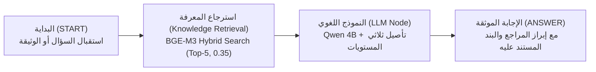

# دليل استخدام مساعد «بصيرة — Baseera Docs» للتحليل الذكي للوثائق والعقود

> **الإصدار:** 1.0.0  
> **المنصة:** Dify v1.18.0 + Ollama (Qwen 2.5/3.5 4B & BGE-M3)  
> **نوع التطبيق:** سير عمل محادثة ذكي (Chatflow Architecture)  
> **تاريخ التحديث:** نوفمبر 2026

---

## 1. نظرة عامة على المنتج (Product Overview)

**«بصيرة — Baseera Docs»** هو مساعد رقمي ذكي ومتخصص ومحلي بالكامل (100% Local On-Premise) أُنشئ لتمكين رواد الأعمال، المستشارين القانونيين، مديري المشاريع، وفرق المشتريات من قراءة وفحص وتدقيق ومقارنة وثائق الأعمال والعقود التجارية والاتفاقيات التقنية بدقة واحترافية.

يعتمد «بصيرة» على تقنية **RAG (Retrieval-Augmented Generation)** المتقدمة مع تطبيق **إطار التأصيل ثلاثي المستويات (Three-Level Grounding Framework)** لمنع الهلوسة وفصل الحقائق الموثقة صراحة عن التقديرات التحليلية.

---

## 2. روابط الوصول المباشر (Access & Preview)

| الواجهة | الرابط / نقطة النهاية | الغرض والاستخدام |
| :--- | :--- | :--- |
| **واجهة المحادثة المباشرة (Preview Web UI)** | [http://127.0.0.1/chat/1b555bfe-8c5d-401b-bdd6-3a7862f467ff](http://127.0.0.1/chat/1b555bfe-8c5d-401b-bdd6-3a7862f467ff) | الاستخدام اليومي التفاعلي للمستخدم النهائي (طرح أسئلة، رفع وثائق) |
| **محرر استوديو Dify (Studio Workflow)** | [http://127.0.0.1/app/1b555bfe-8c5d-401b-bdd6-3a7862f467ff/workflow](http://127.0.0.1/app/1b555bfe-8c5d-401b-bdd6-3a7862f467ff/workflow) | التعديل، التحسين، وفحص المخطط الانسيابي وقواعد التوجيه |
| **واجهة برمجة التطبيقات (API Endpoint)** | `POST http://127.0.0.1/v1/chat-messages` | التكامل البرمجي عبر HTTP/JSON |
| **مفتاح الواجهة (API Secret Key)** | `Bearer app-8lKs1YovQpVBxKJ2Utm1VrTI` | مصادقة استدعاءات الـ API |

---

## 3. المعمارية الهندسية ومسار المعالجة (Chatflow Architecture)

يعتمد المساعد على تصميم خطي احترافي فائق الكفاءة والسرعة، يمر بالأربع مراحل التالية:



1. **عقدة البداية (Start Node):** تستقبل نص السؤال ومدخلات المستخدم، مع دعم استقبال المرفقات والملفات بصيغ (PDF, DOCX, MD, TXT).
2. **عقدة استرجاع المعرفة (Knowledge Retrieval Node):** تقوم بالبحث الهجين (Vector + Keyword) في قاعدة المعرفة المعتمدة `Baseera Docs — Evaluation Knowledge`، وتسترجع أدق 5 فقرات ذات صلة بحد أدنى لدرجة التطابق 0.35.
3. **عقدة النموذج اللغوي (LLM Node - Qwen 4B):** تُشغّل نموذج `qwen3.5:4b` المحلي بدرجة حرارة حذرة (`temperature: 0.2`) مع تطبيق صارم لقواعد الاستدلال.
4. **عقدة الرد النهائي (Answer Node):** تُخرج الإجابة النهائية المنظمة باللغة العربية أو الإنجليزية مع إرفاق المراجع القانونية المستخدمة (`retriever_resources`).

---

## 4. إطار التأصيل المعرفي ثلاثي المستويات (Grounding Framework)

يلتزم «بصيرة» بنظام إجابة منضبط يصنف أي استفسار إلى واحد من ثلاثة مستويات:

```
┌────────────────────────────────────────────────────────────────────────┐
│                      إطار التأصيل المعرفي (بصيرة)                      │
├─────────────────┬──────────────────────────────────────────────────────┤
│ المستوى الأول   │ حقائق موثقة صراحة (Explicit Facts)                  │
│ Level A         │ إجابة حاسمة، موثقة برقم البند واسم الوثيقة والاقتباس. │
├─────────────────┼──────────────────────────────────────────────────────┤
│ المستوى الثاني  │ تحليل واستنتاج معقول (Reasonable Interpretation)     │
│ Level B         │ تحليل مهني موضوعي مع تنويه صريح أنه قراءة وليس فتوى.  │
├─────────────────┼──────────────────────────────────────────────────────┤
│ المستوى الثالث  │ معلومات غير متوفرة / قوالب فارغة (Missing Data)       │
│ Level C         │ اعتذار صريح ومهني عن الإجابة دون اختلاق أي بيانات.    │
└─────────────────┴──────────────────────────────────────────────────────┘
```

### كيف تتعامل مع كل مستوى؟

* **المستوى أ (Level A - حقائق صريحة):**
  * *السؤال:* "ما هي مدة الضمان المجاني في عقد الحلول الرقمية؟"
  * *طريقة إجابة بصيرة:* يحدد المدة بدقة (30 يوماً من تاريخ التوقيع على محضر الاستلام النهائي) ويشير صراحة للبند الثامن.
* **المستوى ب (Level B - تحليل واستنتاج ومخاطر):**
  * *السؤال:* "هل توجد خطورة على العميل في صياغة البند الثالث بشأن مهلة الفحص؟"
  * *طريقة إجابة بصيرة:* يوضح أن البند ينص على اعتبار البرمجيات مقبولة حكماً إذا مرت 7 أيام دون اعتراض كتابي، وينبه العميل إلى خطورة ضيق الوقت، مع إضافة التنويه النظامي: *(تنويه: هذا التحليل يمثل قراءة فنية استرشادية لبنود العقد ولا يعد استشارة قانونية نظامية رسمية)*.
* **المستوى ج (Level C - نواقص أو مصائد هلوسة):**
  * *السؤال:* "كم تبلغ قيمة الدفعة الأولى المحددة بنسبة مئوية في جدول الدفعات؟"
  * *طريقة إجابة بصيرة:* يوضح أن النسبة تُرِكت كخانة فارغة بقوسين `[.....]%` ولم يُحدد رقم صريح في مسودة العقد، ويرفض اختلاق نسبة افتراضية كـ 30% أو 50%.

---

## 5. أمثلة وتطبيقات عملية (Practical Sample Prompts)

### أ) استخراج الالتزامات التعاقدية (Obligations Extraction)
> **الصيغة المقترحة:**  
> *"استخرج جميع الالتزامات الواقعة على عاتق مقدم الخدمة بموجب عقد الحلول الرقمية، وصنفها في نقاط محددة."*  
> **النتيجة المتوقعة:** قائمة مرتبة ببنود التسليم، مطابقة المواصفات، الضمان 30 يوماً، تسليم الأكواد بعد السداد الكامل.

### ب) مقارنة مسودتين لعقد واحد (Contract Version Comparison)
> **الصيغة المقترحة:**  
> *"قارن بين النسخة النهائية لعقد الخدمات الرقمية والنسخة السابقة v1.0.0 من حيث أحكام الملكية الفكرية وشروط السداد."*  
> **النتيجة المتوقعة:** جدول مقارن يوضح أن النسخة السابقة لم تكن تشترط سداد كامل المستحقات لنقل الملكية الفكرية، بينما النسخة النهائية قيدت الانتقال بالسداد التام.

### ج) فحص المخاطر وكشف الثغرات (Risk Analysis & Ambiguity)
> **الصيغة المقترحة:**  
> *"ما هي المخاطر التي تترتب على العميل في حال تأخره عن سداد الدفعة النهائية؟ وما هي الصلاحيات الممنوحة للمطور؟"*  
> **النتيجة المتوقعة:** توضيح حق المطور في تعليق تشغيل الخوادم، حجب الشفرة المصدرية، وعدم تسليم المفاتيح الرقمية حتى تصفية الحساب.

### د) تلخيص الاتفاقيات الطويلة (Agreement Summarization)
> **الصيغة المقترحة:**  
> *"لخص في 5 أسطر أحكام حماية المعلومات السرية ومدة سريانها في اتفاقية Bonterms Mutual NDA."*  
> **النتيجة المتوقعة:** ملخص مركز يشير إلى التزام الطرفين بدرجة العناية المعقولة (Reasonable Care) وسريان الالتزام لعدة سنوات بعد الإنهاء.

---

## 6. رفع وتحليل وثائق جديدة (Uploading New Documents)

إذا أردت تحليل عقد أو اتفاقية جديدة غير موجودة في قاعدة البيانات الأساسية:

1. افتح واجهة المحادثة المباشرة: `http://127.0.0.1/chat/1b555bfe-8c5d-401b-bdd6-3a7862f467ff`
2. اضغط على أيقونة **المرفقات (Paperclip / Upload)** بجانب صندوق الكتابة.
3. اختر ملف الوثيقة (الصيغ المدعومة: `PDF`، `DOCX`، `MD`، `TXT`).
4. اكتب سؤالك المحدد مثل: *"راجع هذا العقد واستخرج شروط الفسخ والتعويضات"* ثم اضغط إرسال.
5. سيقوم المساعد بمعالجة الملف المرفق واستخلاص الإجابة بالاستناد المباشر إلى نصوصه.

---

## 7. حدود الاستخدام والمحددات النظامية (Limitations & Disclaimer)

1. **الاسترشاد لا الإلزام:** إن تحليلات واستنتاجات «بصيرة» هي أدوات مساعدة للأعمال وفحص المستندات، ولا تغني بأي حال عن التوثيق النظامي والاستشارة القانونية المعتمدة من محامٍ أو مستشار مرخص.
2. **الاعتماد على جودة المدخلات:** تعتمد دقة الإجابة على جودة ووضوح المستند؛ المستندات المصورة ذات الجودة المتدنية (Scanned PDFs) قد تحتاج لمعالجة OCR قبل إدخالها.
3. **الحفاظ على الخصوصية الكاملة:** جميع البيانات والوثائق والاستفسارات تعالج محلياً 100% داخل الخادم ولا تغادر الشبكة المحلية إطلاقاً.

