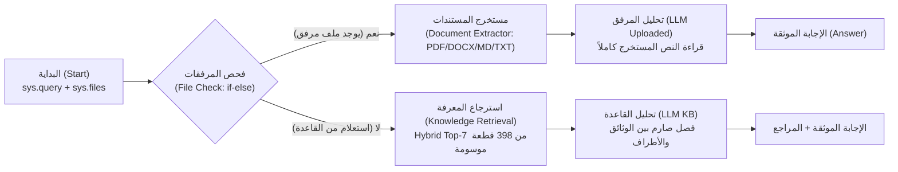

# دليل استخدام مساعد «بصيرة — Baseera Docs» للتحليل الذكي للوثائق والعقود

> **الإصدار المنشور:** 1.1.0 (`Published v1.1.0`)  
> **المنصة:** Dify v1.18.0 + Ollama (`qwen3.5:4b` & `bge-m3:latest`)  
> **تاريخ التحديث:** 10 نوفمبر 2026

---

## 1. نظرة عامة على المنتج (Product Overview)

**«بصيرة — Baseera Docs»** هو مساعد محلي 100% (On-Premise) لتحليل واستخراج ومقارنة وثائق الأعمال والعقود والاتفاقيات باللغتين العربية والإنجليزية. يعتمد على بنية RAG هجينة مع معالجة مباشرة للمرفقات (`Document Extractor`) وتطبيق **إطار التأصيل ثلاثي المستويات (Level A / B / C)** لمنع الهلوسة واختلاق البنود.

---

## 2. روابط الوصول المباشر الآمنة (Verified Access Endpoints)

| الواجهة | الرابط الفعلي المعتمد | الغرض والاستخدام |
| :--- | :--- | :--- |
| **واجهة المحادثة المنشورة (Publish WebApp UI)** | [http://127.0.0.1/chat/JWUhTnPUst1llzGJ](http://127.0.0.1/chat/JWUhTnPUst1llzGJ) | الاستخدام اليومي التفاعلي للمستخدم النهائي (طرح الأسئلة ورفع PDF / DOCX مباشرة) |
| **استوديو سير العمل (Dify Studio)** | [http://127.0.0.1/app/1b555bfe-8c5d-401b-bdd6-3a7862f467ff/workflow](http://127.0.0.1/app/1b555bfe-8c5d-401b-bdd6-3a7862f467ff/workflow) | مراجعة وتعديل المخطط الانسيابي وسجل التشغيل |
| **واجهة برمجة التطبيقات (REST API)** | `POST http://127.0.0.1/v1/chat-messages` | التكامل البرمجي عبر HTTP/JSON |
| **مفتاح المصادقة (API Token)** | يُقرأ محلياً من ملف `.secrets/baseera_api_token.env` (خارج Git) | يُمنع نشر أو تدوين مفاتيح الـ API داخل المستندات أو المستودعات |

---

## 3. المعمارية الهندسية في الإصدار v1.1.0 (Workflow Architecture)

يمر الطلب عبر مسارين واضحين يحافظان على بساطة سير العمل ويفصلان بدقة بين الملفات المرفوعة حديثاً وقاعدة المعرفة المفهرسة:

---

## 4. إطار التأصيل ثلاثي المستويات (Grounding Framework)

1. **المستوى أ (Level A — حقيقة موثقة صراحة):** إجابة مباشرة ومؤصلة باسم الوثيقة ورقم البند الفعلي المكتوب في النص.
2. **المستوى ب (Level B — استنتاج وتحليل منطقي للمخاطر):** قراءة استرشادية متوازنة مع تنويه واضح بأنها تحليل منطقي وليست استشارة قانونية نظامية رسمية.
3. **المستوى ج (Level C — معلومة غير منصوص عليها أو خانة فارغة):** تصريح أمين بعدم وجود المعلومة (مثل رقم آيبان غير مذكور أو نسبة `[.....]%` فارغة) دون أي تخمين.

---

## 5. رفع وفحص ملفات PDF وDOCX عبر واجهة Publish

1. افتح رابط النشر الرسمي: `http://127.0.0.1/chat/JWUhTnPUst1llzGJ`
2. اضغط على أيقونة إرفاق الملفات بجانب مربع الإدخال، واختر ملفاً بصيغة `PDF` أو `DOCX` أو `MD` أو `TXT` (بحد أقصى 3 ملفات في الرسالة الواحدة).
3. عند إرسال سؤالك، يقوم `Document Extractor` باستخراج النص والجدول داخل الملف وتمريره مباشرة إلى النموذج اللغوي.
4. **تنويه مهم حول الحجم والذاكرة:** ضمن حد السياق المحلي الافتراضي (`4096` tokens)، يعمل تحليل المرفقات بدقة كاملة على المستندات والملخصات التي يصل طول نصها إلى نحو **10,000–12,000 حرف** (قرابة 3–5 صفحات نصية). للمستندات الضخمة جداً (مثل 180KB+)، يُنصح بتلخيصها أو فهرستها في قاعدة المعرفة لتجزئتها واسترجاعها على مقاطع.
5. في المحادثات متعددة الأدوار حول نفس الملف المرفوع، يُنصح بإبقاء الملف مرفقاً أو طرح الأسئلة المتتابعة مباشرة؛ وإذا طُرح سؤال دون مرفق، سيبحث النظام في قاعدة المعرفة الرئيسية.

---

## 6. نماذج أسئلة عملية موصى بها (Sample Prompts)

- **تحليل ملف مرفق:** *"استخرج الأطراف، القيمة الإجمالية للعقد، جدول الدفعات، غرامة التأخير، ومدة الضمان من الملف المرفق."*
- **استخراج الالتزامات من قاعدة المعرفة:** *"استخرج الالتزامات الأساسية الواقعة على الطرف الثاني (الشركة) في البند الخامس من عقد الحلول الرقمية."*
- **مقارنة نسختين:** *"قارن بين النسخة النهائية لعقد الحلول الرقمية والنسخة السابقة v1.0.0 في مهلة المراجعة وشروط الاسترداد عند الإلغاء."*
- **كشف النواقص والمخاطر:** *"في البند الثالث من عقد الحلول الرقمية، ما خطورة قاعدة الموافقة الضمنية بعد 15 يوم عمل على العميل؟"*
