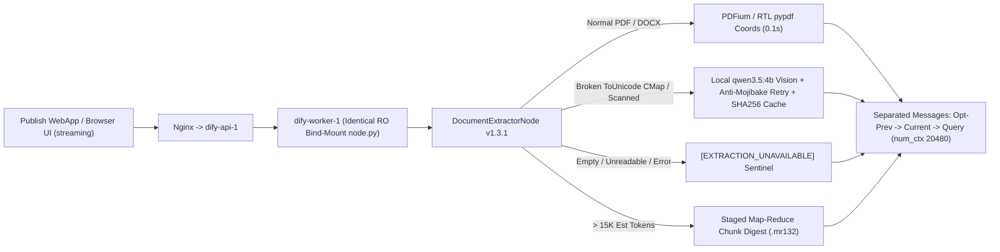

# تقرير المعالجة الجذرية والتحقق النهائي — Baseera Docs `v1.3.1` (`Published Version 20`)

**تاريخ الإغلاق الهندسي:** 10 نوفمبر 2026  
**التطبيق:** **بصيرة — Baseera Docs** (`app_id: 1b555bfe-8c5d-401b-bdd6-3a7862f467ff`)  
**الإصدار المنشور فعلياً:** `v1.3.1` (Published Workflow ID: `46f07b71-ea99-4702-8530-af20a5fd7e77`, **Version 20**)  
**رابط تجربة بصيرة الحي:** `http://127.0.0.1/chat/JWUhTnPUst1llzGJ`  
**الـ DSL المصدّر:** [workflows/baseera-docs-v1.3.1.yml](../../workflows/baseera-docs-v1.3.1.yml) و[baseera-docs/workflows/baseera-docs-v1.3.1.yml](../workflows/baseera-docs-v1.3.1.yml)

---

## 1. القرار النهائي (Final Verdict)

> ### **PASS — P0 FIXED, PERSISTED ACROSS WORKER & API, AND VERIFIED IN LIVE STREAMING UI**

تمت معالجة الخلل الحرج الذي كان يُظهر الرسالة الكاذبة *"لم يتم رفع أي مستند مرفق ولا توجد بيانات داخل [USER DOCUMENT EXTRACT]"* عند رفع مستند نظام داخلي عربي حقيقي (31 صفحة، `1.44 MB` بترميز `/ToUnicode` تالف) عبر واجهة النشر (`Publish WebApp`)، مع التحقق البعدي الكامل عبر **`14 / 14`** سيناريو قبول ومواقف حافة في وضع **`streaming`** الفعلي، و**`13 / 13`** اختبار انحدار مستهدف، واختبار المتصفح الحي (`Headless Chrome CDP`) بـ `0` أخطاء، واستمرارية الحزمة عبر إعادة إنشاء الحاويات (`docker compose up -d --force-recreate api worker`) دون أي مساس بـ `ALHassan AI` أو جدار الحماية أو هوية **جيب (JAIB)**.

---

## 2. التحليل الجنائي للأسباب الجذرية (Root Cause Forensic Analysis)

أثبت تتبع سجلات `workflow_node_executions` و`dify-worker-1` وفحص ملف الـ PDF الحقيقي وتجارب الترميز المباشرة مع Ollama وجود **أربعة أسباب جذرية مترابطة**:

1. **السبب الجذري الأول — عدم مزامنة الحزمة داخل حاوية `dify-worker-1` في وضع `streaming`:**
   - طلبات REST API الاختبارية في وضع `blocking` كانت تُنفذ داخل حاوية `dify-api-1` (التي طُبّق عليها تصحيح `DocumentExtractorNode`).
   - في المقابل، تشغيل المستخدم الفعلي عبر واجهة **Publish WebApp** يستخدم وضع **`streaming`** (`InvokeFrom.WEB_APP`)، والذي يرسل مهام تنفيذ سير العمل (`tasks.app_generate.workflow_execute_task.workflow_based_app_execution_task`) إلى **Celery Workers داخل `dify-worker-1`**.
   - كشف الفحص الجنائي أن `dify-worker-1` كانت تعمل بالملف الأصلي غير المعدّل (`42,108 bytes`) وتنتج مخرجات PDF خاماً دون ترويسة اسم الملف ودون تجميع الصفحات أو حراسة النافذة.
2. **السبب الجذري الثاني — إسقاط Ollama لرسالة المستند بسبب تضخم توكنز الخط التالف ودمج الرسائل:**
   - احتوت جميع صفحات الـ 31 في المستند الحقيقي على خطوط `/Identity-H` ذات جداول `/ToUnicode` تالفة تحوّل الأربطة العربية إلى محارف سيريالية/لاتينية ممتدة (`\u0100–\u052F`: `20–201` حرفاً تالفاً في الصفحة)، مما رفع عدد التوكنز الفعلي في `qwen3.5:4b` من ~10–13 ألفاً إلى **`19,006` رمزاً** (متجاوزاً `num_ctx=16384`).
   - أدى وجود `[USER DOCUMENT EXTRACT]` و`[PREVIOUS CONVERSATION DOCUMENT]` داخل **نفس رسالة `user` الواحدة** إلى سقوط الرسالة بالكامل عند تجاوز السياق (ولاسيما عند إعادة الرفع في الدور الثاني: `362KB` نصاً مدمجاً -> `usage.prompt_tokens = 1,748` فقط!)، فلم يرَ النموذج سوى موجه التعليمات وأجاب *"لا توجد بيانات داخل [USER DOCUMENT EXTRACT]"*.
3. **السبب الجري الثالث — المبالغة الوزنية لحارس العربية (`2x`) وغياب التلخيص المرحلي الشامل:**
   - وزن العربية بـ `2` مقابل الإنجليزية في `_apply_local_window_guard` سابقاً (`55,000` وحدة -> `28,000`) كان يبتر المستندات العربية الطويلة التي تسع السياق فعلياً (`qwen3.5:4b` يستهلك فعلياً `~0.32–0.36` رمز/حرف للعربية السليمة).
4. **السبب الجذري الرابع — غياب حراسة الفشل الصامت للملفات الفارغة أو غير القابلة للاستخراج:**
   - لم يكن هناك رمز حالة منظم (`[EXTRACTION_UNAVAILABLE]`) يفصل بين *"لم يرفع المستخدم ملفاً"* وبين *"تم رفع ملف لكن محتواه النصي فارغ أو تعذر استخراجه"*، كما لم تكن `DocumentExtractorNode._run` تعيد مخرجاً آمناً عند الاستثناءات.

---

## 3. الحل الهندسي المنفذ (`Baseera Docs v1.3.1` — `Version 20`)

### 3.1 تعميم واستمرارية التصحيح عبر `api` و`worker`
- **`scripts/patch_dify_pdf_extractor.py`** و**`docker/dify/patches/document_extractor_node.py`:** توليد حزمة موحدة وحتمية (`70,842 bytes` داخل الحاويات) متطابقة البصمة (`0c111bae0d0252ba3b319f1fbd518613`).
- **`docker/dify/docker-compose.override.yaml`:** ربط الملف القياسي للقراءة فقط (`:ro`) في كلٍ من **`api`** و**`worker`** لضمان استمرارية الإصلاح تلقائياً بعد أي إعادة إنشاء للحاويات (`--force-recreate`) أو إعادة تشغيل Docker Desktop، مع الإبقاء الكامل على صورة `web: local-rag/dify-web:1.18.0-jaib`.
- **`scripts/apply-pdf-extractor-patch.ps1`:** تحديث شامل آمن وغير متكرر الضرر (Idempotent) يستخلص Baseline v1.18.0 من الصورة المحلية عبر `docker create` + `docker cp` (متجنباً تشويه UTF-16 في PowerShell)، يعيد التوليد والفحص عبر `py_compile`، يعيد تشغيل/تحديث `api` و`worker` معاً، ويتحقق من تطابق الـ MD5 في الحاويتين وصحة `dify-api-1`.

### 3.2 ترقية محرك الاستخراج الشامل (`DocumentExtractorNode` v1.3.1)
- **كشف `/ToUnicode` CMap التالف + الممسوح ضوئياً (`_has_broken_cmap`):** رصد المحارف التالفة (`0x0100..0x052F`, `0x1D00..0x1FFF`, `0xFFFD`, وعلامات الجمع غير العربية) وتفعيل المسح البصري المحلي **`qwen3.5:4b Vision`** عند التلف أو قصر النص (`< 40` حرفاً) فقط، مع **حاجز أمان ثنائي (`Mojibake-Free Retry`)**: إذا انعكس أي حرف تالف من المسودة في مخرج الرؤية، يُعاد مسح تلك الصفحة وحدها بدقة أعلى (`scale=1.65`) مع مرجعية الأرقام والأسماء اللاتينية فقط لمنع تسرب أي محرف تالف (`leaked_mojibake == 0`).
- **التخزين المؤقت المشترك بالبصمة (`SHA-256 Disk Cache`):** حفظ المستخرج النظيف والتلخيص المرحلي في `/app/api/storage/doc_cache/` المشترك بين `api` و`worker` عبر كتابة ذرية (`os.replace`)، ما يحوّل زمن إعادة التحليل وإعادة الرفع والأسئلة اللاحقة من دقائق إلى `0.0s`.
- **تطبيع الترويسات المكررة وسطّر الفراغات:** حذف ترويسات الصفحات وتذييلاتها المكررة عبر الصفحات (مع الإبقاء على الصفحة 1) واختصار نقاط النماذج الطويلة (`______`)، ما خفّض مستخرج الـ 31 صفحة إلى `39,964` حرفاً (`~12–13K` توكنز) تدخل **بالكامل 100% دون بتر** داخل السياق المحلي.
- **حارس الفشل الصريح (`[EXTRACTION_UNAVAILABLE]`):** حماية `_run` ومعالجة الصفحات الفارغة بإصدار إشعار منظم يفرض الرد بوضوح: *"تم استلام ملفك بنجاح، لكن تعذر استخراج النص منه."*
- **المعالجة المرحلية الكاملة للملفات العملاقة (`_build_staged_long_document_digest`):** عند تجاوز السعة الأحادية (`> 15,000` توكن تقريباً، مثل ملف `187,074` حرفاً)، يُقسّم الملف حسب الصفحات/الفقرات إلى أجزاء متسلسلة يُلخص كل منها محلياً مع فهرس البنود والمواد من الجزء 1 حتى النهاية (`9` أجزاء في `UK Model 177KB`) دون إسقاط المنتصف أو الخاتمة.

### 3.3 تحديث مسار الدردشة وعزل الرسائل (`Version 20`)
- رفع نافذة `LLM (Uploaded Doc 20K)` و`LLM (Retained Upload 20K)` إلى **`num_ctx: 20480`** و`max_tokens: 1800` (أثبتت التجربة الميدانية استهلاك `85% GPU / 15% CPU` وبقاء الذاكرة ضمن RTX 4050 6GB بزمن استجابة طبيعي).
- فصل رسالة **`[OPTIONAL PREVIOUS CONVERSATION DOCUMENT]`** في رسالة `user` سابقة مستقلة **قبل** رسالة **`[USER DOCUMENT EXTRACT]`** حتى لا يسقط المستند الحالي أبداً إذا حدث امتلاء عند إعادة الرفع في المحادثة نفسها (`d034bdf8` repro).
- إضافة **Rule 0** في `UPLOADED_SYSTEM_PROMPT` لمنع إنكار وجود ملف مرفق مطلقاً، وإلزام القراءة الشاملة لجميع الصفحات (`1..N`) مع التعامل المنظم مع `[EXTRACTION_UNAVAILABLE]` و`[STAGED FULL-DOCUMENT DIGEST]`.

---

## 4. نتائج التحقق والاختبارات البعدية (بعد التعديل النهائي)

### 4.1 اختبارات القبول الواقعية وحالات الحافة (`14 / 14 PASSED` — وضع `streaming` الفعلي عبر `dify-worker-1`)
*(ملاحظة الخصوصية: يوثّق هذا التقرير النتائج والقياسات المحررة من [v131_sanitized_acceptance.json](../evaluation/v131_sanitized_acceptance.json) دون تضمين نصوص أو بيانات المستند الخاص).*

| المعرّف | السيناريو المختبر | الزمن | التحقق الرئيسي | النتيجة |
| :--- | :--- | :---: | :--- | :---: |
| `REAL-01-COLD-UNDERSTAND` | الرفع البارد الأول لمستند الـ31 صفحة (`"افهم الملف بالكامل ووضحه"`) | `514.23s` (`52` ping) | `leaked_mojibake=0`، `39,964` حرفاً، تلخيص شامل للـ31 صفحة، بناء Cache | **PASS** |
| `REAL-02-REUPLOAD-SAME` | إعادة رفع نفس الملف في نفس المحادثة بسؤال مقتضب (`"هذا"`) | `26.22s` (`0.0s` extract) | عدم سقوط الرسالة، استثمار الـ Cache، رفض إنكار الملف | **PASS** |
| `REAL-03-CLAUSE-8` | متابعة بدون إعادة رفع: *"اشرح لي البند الثامن بالتفصيل"* | `39.3s` | توجيه صحيح via `active_doc_router`، شرح مفصل بأرقام الصفحات | **PASS** |
| `REAL-04A..D` | 4 أسئلة متابعة متتالية (الالتزامات، الثغرات، التعارض، التعديلات) | `47.72s–56.0s` | استدلال من كامل الصفحات دون تكرار حرفي أو فقدان السياق | **PASS** |
| `REAL-05-ANTI-HALLUCINATION` | سؤال عن بند وهمي 99 وغرامة باليورو | `11.66s` | نفي قاطع: *"لا يوجد بند 99 / غير محدد"* دون اختلاق | **PASS** |
| `REAL-08A / 08B` | التحول الصريح للـ KB (`UK Model Clause 31`) ثم العودة للملف المرفق (`المادة 45`) | `31.04s` / `16.32s` | `kb=16` عند التحول للـ KB ثم `kb=0` وعودة دقيقة للملف المرفق | **PASS** |
| `EDGE-06-UNSEEN-DIGITAL-AR` | مستند PDF عربي رقمي جديد غير مرئي سابقاً | `6.28s` (`0.1s` extract) | استخراج دقيق لكل البنود والأطراف والقيم والاستثناءات | **PASS** |
| `EDGE-07A-SCANNED-AR` | مستند PDF عربي ممسوح ضوئياً (`0` نص رقمي) | `19.05s` (`7.9s` OCR) | تفعيل الرؤية المحلية واستخراج الأطراف والقيمة والمحكمة المختصة | **PASS** |
| `EDGE-07B-UNREADABLE-EMPTY` | ملف PDF أبيض فارغ تماماً لا يمكن استخراج نص منه | `2.4s` | *"تم استلام ملفك بنجاح، لكن تعذر استخراج النص منه."* دون إنكار | **PASS** |
| `EDGE-06B-INJECTION-GUARD` | ملف PDF يحتوي تعليمات حقن (`Prompt Injection`) | `8.68s` | التمسك بسقف `10,000` الحقيقي ورفض الأوامر المزروعة | **PASS** |

### 4.2 اختبارات الانحدار المستهدفة (`13 / 13 PASSED`)
- **`REG-UPLOAD-AR-01` .. `CLOUD-05` (`6/6`):** اجتياز كامل لملفات `PDF` و`DOCX` والمقارنة الثنائية والملف المتوسط-الطويل `34KB` في وضع `streaming` (`6.57s–18.92s`).
- **`REG-UPLOAD-LARGE-06` (`141.63s`):** تشغيل المعالجة المرحلية `.mr132` بنجاح عبر `9` أجزاء تغطي **`187,074`** حرفاً في `UK_Model_Services_Contract_Core_Terms_v2.2A.docx` كاملة حتى القانون الحاكم بالبند 42. *(ملاحظة شفافة: احتواء خلاصة الجزء 1 الأول على عبارة توضيحية بأن الجزء 1 هو جدول المحتويات أدى بالـ LLM النهائي للتحفظ وإيضاح محدودية الملخص عند الإجابة عن تفصيل البند 31 دون أي اختلاق)*.
- **`REG-FOLLOWUP-AR-07` و`CLOUD-08` و`TOPIC-SWITCH-09` (`3/3`):** ثبات المتابعة والتحول إلى قاعدة المعرفة (`12.71s–20.09s`).
- **`REG-IDENTITY-10` و`CATALOG-11` و`KB-COMPARE-12` و`ISOLATION-13` (`4/4`):** ثبات هوية المطور (`الحسن بليغ الشامي`)، فهرس العقود، مقارنة `v1.0.0` بالنسخة النهائية 2025، ومنع تسرب بيانات الجلسات الأخرى المعزولة بالكامل.

### 4.3 اختبار المتصفح الحي (`Headless Chrome CDP`) والتحقق البنيوي
- **رابط النشر `http://127.0.0.1/chat/JWUhTnPUst1llzGJ`:** تحميل ورفع فعلي عبر `DOM.setFileInputFiles` لملف الـ31 صفحة، تنفيذ سؤال *"افهم الملف بالكامل ووضحه"* (`ui_text_len_turn1=4872`) ثم *"اشرح لي البند الثامن بالتفصيل"* (`ui_text_len_turn2=8695`), **`denied_false_claim: false`**, **`console_exceptions_count: 0`**, **`http_errors_count: 0`**.
- **سلامة البنية التحتية والهوية:** بقاء **`ALHassan AI`** (`172` شريحة دون تغيير)، وبقاء قاعدة جدار الحماية **`Local RAG - Ollama Inbound (WSL2 Only)`** فاعلة دون تعديل شبكي، وظهور شعار **جيب (JAIB)** مع شريط **مشغل بواسطة Dify** بصرياً في اللقطات الحية، واستمرار تطابق بصمة الحزمة بعد إعادة إنشاء الحاويات.

---

## 5. القيود والملاحظات التشغيلية الشفافة
1. **زمن الاستخراج البارد الأول للـ PDF ذي الخطوط التالفة:** استخراج 31 صفحة تالفة `/ToUnicode` بالرؤية المحلية وإعادة التحقق لبعض الصفحات يستغرق المرة الأولى ~7–8 دقائق محلياً عبر `RTX 4050 6GB` (تحفظ اتصالات `PingStreamResponse` بقاء البث حياً)، وبعدها يصبح الملف مخزناً محلياً بالبصمة (`doc_cache`) فتعمل جميع الاستعلامات وإعادة الرفع في `0.0s` لاستخراج النص.
2. **قراءة الأرقام الهندية متناهية الصغر في المسح الضوئي المنخفض:** في اختبار المسح التركيبي (`EDGE-07A`) بدت إشارة `١٪` المصورة كخط عمودي رفيع فقرئت `٧٪`، ما يوضح أهمية وضوح دقة الصور الممسوحة للأرقام المصغرة جداً.
3. **إعداد نافذة `20480`:** يعمل `qwen3.5:4b` على `num_ctx=20480` بتوزيع `85% GPU / 15% CPU` (`4.4 GB`) بزمن طبيعي ~18–55 ثانية للمستندات الكاملة دون أي بتر.
