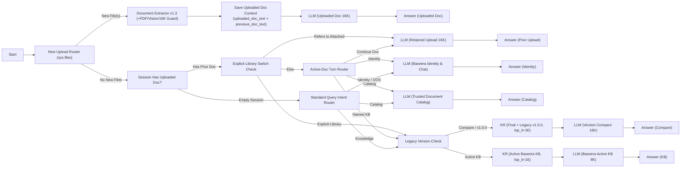

# تقرير القبول النهائي والإصدار — Baseera Docs `v1.3.0` (`Published Version 19`)

**تاريخ الاعتماد:** 10 نوفمبر 2026  
**التطبيق:** **بصيرة — Baseera Docs** (`app_id: 1b555bfe-8c5d-401b-bdd6-3a7862f467ff`)  
**الإصدار المنشور فعلياً:** `v1.3.0` (Published Workflow ID: `e51cbe14-b483-42fe-b643-93645da3eff0`, **Version 19**)  
**رابط تجربة بصيرة المنشور فعلياً:** `http://127.0.0.1/chat/JWUhTnPUst1llzGJ`  
**رابط استوديو سير العمل:** `http://127.0.0.1/app/1b555bfe-8c5d-401b-bdd6-3a7862f467ff/workflow`  
**المستودع والمرجع قبل التزام الإصدار:** `https://github.com/a2sn2/local-rag-dify` (`main`, Base Commit: `1325bc1e249b7ef35982f78730b5f3a8894e10be`)

---

## 1. القرار النهائي (Final Release Decision)

> ### **PASS — MVP RELEASE READY**

اجتازت النسخة **`v1.3.0` (Published Workflow Version 19)** كافة بوابات القبول الحرجة (`14 / 14 = 100.0%`) وحزمة القبول والسيناريوهات الإضافية (`25 / 25 = 100.0%`)، وحزمة رفع الملفات والمتابعة والتحول عبر واجهة النشر (`9 / 9 = 100.0%`)، وحققت **`49 / 50 (98.00%)`** في تقييم قاعدة المعرفة (`14 / 14` على الأسئلة المستقلة و`35 / 36` على الحزمة الأساسية و`50 / 50` في دقة المصادر ومنع الاختلاق)، كما اجتازت اختبار المتصفح الحقيقي (Headless Chrome CDP) بـ `0` أخطاء Console و`0` أخطاء HTTP مع بقاء هوية **جيب (JAIB)** وإسناد **Dify**.  
*(تنبيه مهني: هذا القرار يعني جاهزية الإصدار الأولي للاستخدام والتجربة الفعلية وفق القيود المحلية الموثقة في القسم 7، ولا يعني العصمة المطلقة عن الأخطاء أو الإطلاق الإنتاجي الواسع دون مراجعة بشرية للعقود عالية الحساسية).*

---

## 2. التعديلات التي أُجريت في `v1.3.0` وأسبابها

1. **معالجة قصور استخراج ملفات PDF العربية والهوية البصرية (`scripts/patch_dify_pdf_extractor.py` و`scripts/apply-pdf-extractor-patch.ps1`):**
   - **المشكلة المكتشفة في `v1.2`:** مكتبة `PDFium` الافتراضية كانت تشطر الأربطة العربية (ما حوّل كلمات مثل `سبب أمني` إلى `سبب أمري`)، كما كانت الشعارات والتذييلات المرسومة كمسارات متجهة في الصفحة الأولى (بدون طبقة نص) تغيب كلياً، وتُفتقد أرقام الصفحات وأسماء الملفات وتتكرر الترويسات المزعجة.
   - **الحل المنفذ:** استخراج هجين لكل صفحة يقيس تشتت الحروف العربية ويستبدل الصفحة المتضررة بإعادة بناء إحداثية RTL via `pypdf` (`visitor_text` + فرز خطوط العرض + تطبيع `NFKC` وإصلاح مسافات الكيرننج الآمنة)، مع إضافة Fallback بصري محلي (`100% Local Ollama qwen3.5:4b Vision` عبر `http://host.docker.internal:11434/api/chat`) يُفعّل **فقط** للصفحات الممسوحة ضوئياً (`< 40` حرفاً) أو لترويسة وتذييل الصفحة الأولى عند رصد رسوميات خارج نطاق النص، مع حذف الترويسات المكررة وإضافة `[اسم الملف المرفق: ...]` و`[صفحة X من N]`.
2. **حارس النافذة المحلية المدمج (`_apply_local_window_guard` — 16K GPU Safety Cap):**
   - **المشكلة المكتشفة:** عند رفع ملفات ضخمة جداً مثل `UK Model Services 177KB` (`187,103` حرفاً)، كان Ollama يسقط رسالة المستند كاملة من نافذة `16,384` رمزاً، بينما تعذّر الاعتماد على عقدة `template-transform` لعدم تطابق مفتاح `dify-sandbox-1` المسبق (`HTTP 401`).
   - **الحل المنفذ:** حارس وزني في عملية الاستخراج يمرر جميع العقود الاعتيادية (بما فيها `Bonterms PSA v1.2` كاملًا بـ `46,474` حرفاً `<= 55,000` وحدة موزونة) دون أي قص، وعند تجاوز الحد يقتطع الجزء الافتتاحي فقط (`~28,000` وحدة) مع إرفاق تنبيه صريح بعدد الأحرف غير المعروضة.
3. **إعادة تصميم التوجيه ثنائي الحالة وحفظ الهوية (`Version 19` — `23` عقدة / `27` رابطاً):**
   - **المشكلة المكتشفة في الملاحظات الحقيقية:** الموجه الأحادي السابق خلط أحياناً بين أسئلة عن مطور التشات فلو (`من هو مطور هذا التشات فلو؟`) وبين أسماء الشركات داخل العقد المرفوع، كما ضلّت أسئلة *"ايش عندك من عقود؟"* و*"رد باختصار"* أو اختلطت أسئلة متابعة تطبيق العقد بهوية بصيرة.
   - **الحل المنفذ:**
     - فحص حالة الجلسة أولاً عبر **`Session Has Uploaded Doc?`** (`conversation.uploaded_doc_text`).
     - بوابة **`Explicit Library Switch Check`** حتمية تفصل الأسئلة التي تشير صراحةً إلى *"الملف المرفق"* / `"attached"` لإبقائها على الملف المرفوع (`llm_prior_doc`) بينما تحوّل الأسئلة التي تستهدف مكتبة بصيرة صراحةً (`UK Model`، `قاعدة المعرفة`، `عقد الحلول الرقمية`، `v1.0.0`) مباشرةً إلى قاعدة المعرفة.
     - موجه **`Active-Doc Turn Router`** للجلسات النشطة، وموجه **`Standard Query Intent Router`** للجلسات الفارغة (مع تغطية صريحة لاستعلامات الحقوق والتعديلات الحوارية مثل `PARA-02`).
     - إضافة متغير المحادثة **`previous_doc_text`** لدعم مقارنة ملفين مرفوعين عبر أدوار مختلفة في المحادثة الواحدة.
4. **تقوية الأمان والتسبيب القانوني (`UPLOADED_SYSTEM_PROMPT`، `PRODUCT_IDENTITY_PROMPT`، `DOCUMENT_CATALOG_PROMPT`، `KB_SYSTEM_PROMPT`):**
   - وضع وسم العزل الأمني `[USER DOCUMENT EXTRACT]` كبيانات غير موثوقة لمقاومة حقن الأوامر (`Prompt Injection Guard`).
   - فرض الحفاظ التام على الاستثناءات التعاقدية (مثل عدم الإعفاء من العيوب التقنية، اشتراط الموافقة وآلية التجديد، عدم ضمان استعادة البيانات بعد الإغلاق)، ومنع تكرار إجابات المتابعة (`UAT-07`)، ومنع تسرّب بنود من وثائق متقاربة في البحث (`COMP-02` Single-Document Isolation).
   - تخصيص فهرس موثق (`Trusted Document Catalog`) يفصل بصرامة بين العقود الحكومية البريطانية (`OGL v3.0`) والنماذج مفتوحة المصدر (`Bonterms CC BY 4.0`) والنماذج العربية الاسترشادية المجتمعية غير الحكومية.

---

## 3. خريطة الـ Chatflow النهائي (`baseera-docs-v1.3.yml`)

المخطط الفعلي المصدر من Dify (`workflows/baseera-docs-v1.3.yml` و`baseera-docs/workflows/baseera-docs-v1.3.yml` — `23` عقدة و`27` رابطاً):

---

## 4. إعدادات RAG الفعلية النهائية (Version 19)

| المكوّن | الإعداد الفعلي المعتمد |
| :--- | :--- |
| **نموذج اللغة والتوليد المحلي** | Ollama `qwen3.5:4b` (`think=False`؛ `temperature=0.05` للـ KB والمقارنات و`0.10` للمرفوعات؛ `num_ctx=8192` للـ KB و`16384` للملفات المرفوعة والمقارنات) |
| **نموذج الرؤية الاحتياطي المحلي** | Ollama `qwen3.5:4b` (`think=True`, `num_ctx=16384`, `temperature=0.0`, محصور لصفحات المسح الضوئي أو ترويسة الصفحة 1 عند الحاجة فقط) |
| **نموذج التضمين المحلي** | `bge-m3:latest` على خادم Ollama المحلي (`http://host.docker.internal:11434`) |
| **القاعدة النشطة (`Baseera Docs — Evaluation Knowledge`)** | ID: `0de4f4ec-4c4e-4bc7-bef7-6379466cdfd1` — `433` مقطعاً مترابطاً (7 ملفات نشطة)، بحث هجين موزون (`0.65` دلالي + `0.35` معجمي)، `top_k=16`، `score_threshold=0.20` |
| **القاعدة التاريخية (`Baseera Docs — Legacy Draft v1.0.0`)** | ID: `53f220d3-523d-4b73-ba9a-9e3b214e32bf` — `24` مقطعاً معزولة لمسودة `v1.0.0`، استرجاع دلالي، `kr_compare top_k=30` عند المقارنة فقط |
| **إعدادات رفع الملفات (`Publish UI`)** | مفعّل (`max 3 files`)؛ الامتدادات `.pdf`، `.docx`، `.md`، `.txt`؛ `uploaded_doc_text` و`previous_doc_text` من نوع `array[string]` |

---

## 5. نتائج الاختبارات: قبل التطوير مقابل النسخة النهائية (`v1.3.0 — Version 19`)

| مجموعة الاختبار | `v1.1.0` | `v1.2.0` (`V12`) | `v1.3.0` (`Version 19`) | المرجع التشغيلي المعتمد |
| :--- | :---: | :---: | :---: | :--- |
| **تقييم قاعدة المعرفة الكلي (`50` سؤالاً)** | `31/36` (`86.11%`) | `49/50` (`98.00%`) | **`49 / 50 (98.00%)`** | [independent_eval_v13_results.json](../evaluation/independent_eval_v13_results.json) |
| — الحزمة الأساسية الـ `36` (دون تخفيف المعايير) | `31/36` (`86.11%`) | `35/36` (`97.22%`) | **`35 / 36 (97.22%)`** | إغلاق `PARA-02` و`COMP-02`؛ بقاء `OBLIG-03` بتنسيق `**solely**` برمجياً |
| — الحزمة المستقلة الـ `14` (`V12-01..14`) | غير متوفرة | `14/14` (`100%`) | **`14 / 14 (100.00%)`** | جميع اختبارات الحساب والمقارنة والمصائد ناجحة |
| — دقة نسبة المصادر ومنع الاختلاق (`50` سؤالاً) | 34/36 مصدر | `50/50` (`100%`) | **`50 / 50 (100.00%)`** | `source_ok=50/50` و`clean_ok=50/50` |
| **رفع الملفات + المتابعة + التحول للـ KB (`Publish API`)** | `4/4` أساسي | `9/9` | **`9 / 9 (100.00%)`** | [upload_verification_v13_results.json](../evaluation/upload_verification_v13_results.json) (تحسن `UPLOAD-FOLLOWUP-CLOUD-08` إلى `kb=0`) |
| **حزمة القبول والسيناريوهات الحرجة (`UAT + Extra`)** | غير مختبرة | رُصدت أخطاء PDF/توجيه | **`25 / 25 (100.00%)`** | [uat_v13_sanitized_scorecard.json](../evaluation/uat_v13_sanitized_scorecard.json) |
| — البوابات الحرجة (`Critical Gates`) | — | تعثرت في UAT الحقيقي | **`14 / 14 (100.00%)`** | حفظ الاستثناءات، هوية بصيرة، عدم حقن الأوامر، وعزل الجلسات |
| **اختبار المتصفح الحقيقي (`Chrome Headless CDP`)** | متابعة يدوية | تم التحقق الأساسي | **`PASS` (`0` أخطاء)** | رفع PDF، متابعة، تحول صريح لـ UK Model، وظهور `الاستشهادات` |

---

## 6. نتائج اختبار المستند العربي الحقيقي والسيناريوهات الإضافية (`25 / 25`)

نُفذت حزمة `UAT-01` .. `UAT-16` والسيناريوهات الإضافية عبر النسخة المنشورة فعلياً (جلسة واحدة متعددة الأدوار بـ **رفعة واحدة للملف** مع التبديل لسؤال المطور في منتصف الجلسة والعودة للملف)، مع حجب كامل لنص وبيانات العميل الحساسة من هذا المستودع العام:

| الفئة | عدد الاختبارات | النتيجة على Version 19 | أبرز نقاط التحقق الموثقة |
| :--- | :---: | :---: | :--- |
| **فهرس العقود والاختصار (`UAT-01`, `UAT-01-BRIEF`)** | `2 / 2` | **PASS (`100%`)** | فصل العقود الحكومية (`UK Gov`) والـ `Bonterms` عن القوالب الاسترشادية العربية؛ التزام بالإيجاز عند طلب `رد باختصار`. |
| **استخراج PDF العربي والهوية البصرية (`UAT-02, 03, 13`)** | `3 / 3` | **PASS (`100%`)** | استخراج ترويسة الشركة بالعربية والإنجليزية بصرياً من الصفحة 1، اقتباس البنود بدقة مع صفحات `[صفحة X من 4]`، واختفاء تشوّه `سبب أمري`. |
| **الاستثناءات القانونية والحساسية (`UAT-04, 05, 11, 12, 14, 15, 16`)** | `7 / 7` | **PASS (`100%`)** | حفظ استثناء العيوب التقنية بالبند 6، التمييز بين الإلغاء وغياب التعويض، نفي التجديد التلقائي دون موافقة، نفي الضمان المطلق لاستعادة البيانات، نفي صفة المحفظة الإلكترونية (بند 2)، وإثبات اختيارية أذونات الموقع/الرسائل (بند 12). |
| **الجداول، عدم التكرار، والتوصية (`UAT-06, 07, 08, 09`)** | `4 / 4` | **PASS (`100%`)** | جدول Markdown بقيم `"غير محدد في المستند"`، تشابه نصي `0.093` فقط في `UAT-07` (صفر تكرار مع ربط البنود)، كشف غياب التأمين، وتوصية مشروطة واقعية. |
| **هوية بصيرة وسط المحادثة (`UAT-10`) والعودة (`UAT-13`)** | `2 / 2` | **PASS (`100%`)** | إجابة `المهندس الحسن بليغ الشامي` عند سؤال *"من هو مطور هذا التشات فلو؟"*، ثم استعادة هوية الشركة المرفوعة في السؤال التالي مباشرة (`10.08s`). |
| **السيناريوهات الإضافية (`EXTRA-03A/B, 04, 05, 06, 07, 08, 09`)** | `8 / 8` | **PASS (`100%`)** | مقارنة ملفين في نفس المحادثة، إجابة عربية على عقد إنجليزي (`Bonterms Cloud`)، إفصاح صادق عن حد الطول (`UK 177KB`)، تحليل مستند جديد غير مستخدم للتدريب (`Bonterms PSA PDF` `11` صفحة)، رفض هلوسة سعر السهم، مقاومة حقن الأوامر (`Prompt Injection PDF`: الإبقاء على `10,000 ريال` ورفض `10,000,000 USD` دون كشف التعليمات)، وعزل تام بين الجلسات (`0%` تسرب في `EXTRA-09`). |

---

## 7. حالات التعثر الآلي والقيود المتبقية بشفافية

1. **`OBLIG-03` (`49 / 50` في التقييم الآلي):** الإجابة سليمة قانونياً بالكامل وتنص بوضوح على *"Data **solely** to: Provide the Cloud Service; Maintain..."* و*"prohibited from disclosing Customer Data"*، ولكنها رُصدت برمجياً كـ `FAIL` بسبب التطابق الصارم لسلسلة `"solely to provide"` دون أي تعديل على معايير الـ 36 الأساسية.
2. **سقف النافذة المحلية (`16,384` رمزاً على GPU `6GB VRAM`):** المستندات الفائقة الحجم (> `55,000` وحدة موزونة، مثل `UK_Model_Services_Contract_Core_Terms_v2.2A.docx` البالغ `187,103` حرفاً) تعرض الجزء الافتتاحي فقط مع تحذير صريح، وتتطلب فهرسة في KB أو تقسيم الملف لقراءة الأقسام المتأخرة. وفي `UPLOAD-LARGE-06` عبّر النموذج عن الحد بعبارة `"16,384-character"` بدلاً من `"token"` مع التزامه الصادق بأن `28,000` حرفاً فقط مرئية وأن `Clause 31` مقتطع.
3. **لغة رد العقد الثنائي (`UPLOAD-DOCX-03`):** عند إرسال سؤال إنجليزي على ملف `Experimental_Test_Service_Agreement_Upload.docx` الذي تغلب عليه الصياغة العربية التعاقدية، استخلصت بصيرة القيم بدقة بالغة لكنها أجابت بالعربية.
4. **استقرار بيئة Windows/WSL2 تحت الضغط واستمرار التصحيح:**
   - أثناء اختبارات متواصلة سابقة، أدى إغلاق مهمة أمر غير مقيمة لعملية `Docker Desktop` الفرعية وإجهاد ذاكرة `16GB RAM` إلى توقف عابر؛ تم حله بتشغيل `Docker Desktop` داخل مهمة دائمة (`IsDaemon`) وإعادة التشغيل النظيف عبر `scripts/start-local-rag.ps1`.
   - تعديل `document_extractor/node.py` محفوظ داخل طبقة الحاوية `dify-api-1`؛ لذا عند استبدال الحاوية مستقبلاً يلزم تشغيل `scripts/apply-pdf-extractor-patch.ps1`.
   - بقي `dify-sandbox-1` غير مستخدم لعدم تطابق مسبق في مفتاح البيئة (`HTTP 401`)، واستُعيض عنه بأمان تام بمنطق حراسة مدمج داخل `DocumentExtractorNode` دون الحاجة إلى `sandbox`.

---

## 8. حالة النسخة الاحتياطية المشفرة

- **الملف الجديد بعد `v1.3.0`:** `backups/backup_20261110_155630.enc`
- **الحجم:** `85,347,260` بايت (`AES-256-GCM`, PBKDF2 100k iterations)
- **SHA-256:** `AC8F8716E36037368B9A807555B4D4EEB4940FC7276F29405B896185953AD874`
- **نتيجة اختبار التحقق (`scripts/verify-backup.ps1`):** **PASSED** — تم التحقق من وسم المصادقة وتطابق بصمات SHA-256 لقاعدة البيانات `PostgreSQL`، و`Weaviate` (`433` Baseera نشط + `24` Legacy + `172` ALHassan + بقية المجموعات)، ومجلد `storage`، و`Redis`، وقائمة نماذج Ollama.

---

## 9. التحقق من عدم المساس بالشبكة، الأمان، وتطبيق `ALHassan AI`، وهوية جيب

- **الشبكة وجدار الحماية:** القاعدة المقيدة `Local RAG - Ollama Inbound (WSL2 Only)` مفعّلة (`Enabled=True`)، والقواعد المفتوحة القديمة معطلة (`Enabled=False`) دون أي تغيير على Wi-Fi أو DNS أو `.wslconfig` أو منافذ Docker؛ ولا تزال الاستدلالات محلية 100% دون أي خدمات سحابية.
- **عزل `ALHassan AI`:** تطبيق `ALHassan AI — Personal Knowledge Assistant` (`a517d042-df7a-4fc0-a1ac-70ffb44236c5`) وقاعدة معرفته (`c58ff9a4-0017-4ebf-9aec-e1d8ff48744f`) بقيا دون أي تعديل وبعدد **`172` مقطعاً مكتملة**.
- **واجهة محفظة جيب (JAIB Wallet) والترخيص:** حاوية `dify-web-1` تعمل بصورة `local-rag/dify-web:1.18.0-jaib`، وتم التحقق بصرياً في Chrome من ظهور شعار **جيب (JAIB)** والألوان (`#E4122D`) ووسم الإسناد **`مشغل بواسطة Dify`**، مع `0` أخطاء Console و`0` أخطاء HTTP (`>= 400`).
- **الأمان ونظافة المستودع:** فحصت كافة المخرجات المرفوعة (`YAML`، السكربتات، التوثيق، ونتائج التقييم القابلة للمشاركة) للتأكد من خلوها من مفاتيح API، ومحتوى المستندات الخاصة الحساسة، وأي ملفات محلية في `.secrets/` أو `scratch/`.

---

## 10. حالة المزامنة والرابط النهائي

- **الحالة المرجعية قبل التزام الإصدار:** `1325bc1e249b7ef35982f78730b5f3a8894e10be` (`origin/main`)؛ وسيُوثّق معرّف الـ Commit النهائي وتطابق `HEAD == origin/main` مباشرة في ملخص الإغلاق المرسل للمستخدم بعد إتمام `git push origin main`.
- **رابط تجربة بصيرة المنشور فعلياً:** `http://127.0.0.1/chat/JWUhTnPUst1llzGJ`
