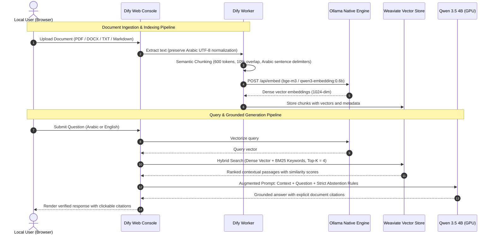

# System Architecture Specification — Local RAG Platform

**Target Stack:** Dify v1.18.0 (Pinned Stable) + Ollama Host Engine + Weaviate Vector DB  
**Deployment Model:** Fully Air-Gapped / Localhost-Bound Single-Machine Architecture  
**Hardware Target:** NVIDIA RTX 3060 Laptop GPU (6GB VRAM) + AMD Ryzen 9 5900HS (16 Threads) + 40GB RAM

---

## 1. High-Level Architectural Topology

```mermaid
flowchart TB
    subgraph HostSystem ["Host Operating System (Windows 11)"]
        subgraph AcceleratedHardware ["Hardware Acceleration Tier"]
            GPU["NVIDIA GeForce RTX 3060 Laptop (6GB VRAM)"]
            CPU["AMD Ryzen 9 5900HS (16 Logical Processors) & 40GB RAM"]
        end

        subgraph OllamaRuntime ["Host Model Engine (Ollama Native Service)"]
            direction TB
            OllamaDaemon["Ollama Daemon (Port 11434)\nBound: Loopback/Internal Gateway\nStrict Firewall Filtering"]
            ChatLLM["Chat LLM: qwen3.5:4b\n(100% GPU Offload | 59.18 tokens/s | num_ctx: 4096)"]
            EmbeddingModel["Embedding Model: bge-m3 / qwen3-embedding:0.6b\n(Multilingual Dense & Sparse Retrieval)"]
            OllamaDaemon --> ChatLLM
            OllamaDaemon --> EmbeddingModel
            ChatLLM -. CUDA Acceleration .-> GPU
            EmbeddingModel -. CUDA Acceleration .-> GPU
        end

        subgraph DockerSubsystem ["Dify Microservices Stack (Docker Compose — v1.18.0)"]
            direction TB
            GatewayProxy["Gateway: Nginx Proxy\nBound: 127.0.0.1:80 (Loopback Only)"]

            subgraph CoreServices ["7 Core Application Services"]
                API["dify-api (Flask Backend Core)"]
                API_WS["dify-api-ws (WebSocket Gateway)"]
                Worker["dify-worker (Celery Document Indexer)"]
                WorkerBeat["dify-worker-beat (Task Scheduler)"]
                WebUI["dify-web (Next.js Dashboard)"]
                PluginDaemon["dify-plugin-daemon (Extensible Plugin Engine)"]
                AgentBackend["dify-agent-backend (Agentic Reasoning Engine)"]
            end

            subgraph DependentServices ["8 Dependent Infrastructure Components"]
                Weaviate["weaviate (Vector Database)"]
                Postgres[("db_postgres (PostgreSQL with pgvector)")]
                Redis[("redis (Broker & Distributed Cache)")]
                SSRF["ssrf_proxy (Squid Outbound Filter)"]
                AgentSSRF["agent_ssrf_proxy (Agent Outbound Filter)"]
                Sandbox["sandbox (Isolated Code Execution)"]
                LocalSandbox["local_sandbox (Agent Execution Sandbox)"]
            end

            subgraph InitTasks ["1 One-Time Task"]
                InitPerms["init_permissions (Volume Perms Setup)"]
            end

            GatewayProxy --> WebUI
            GatewayProxy --> API
            API --> Postgres
            API --> Redis
            API --> Weaviate
            API --> Sandbox
            API --> AgentBackend
            Worker --> Weaviate
            Worker --> Redis
            Worker --> Postgres
            AgentBackend --> LocalSandbox
            AgentBackend --> AgentSSRF
            Sandbox -. Outbound .-> SSRF
        end
    end

    LocalUser(["Local User Browser\nhttp://127.0.0.1:80"]) --> GatewayProxy
    API -- "http://host.docker.internal:11434" --> OllamaDaemon
    Worker -- "Embedding Vectorization" --> OllamaDaemon
```

---

## 2. Microservice Inventory & Component Breakdown

The official Dify 1.18.0 architecture establishes an enterprise-grade multi-tier container topology categorized into:

### 2.1 The 7 Core Application Services
1. **`api` (`langgenius/dify-api`):** The primary Flask backend orchestrating API routing, RAG retrieval workflows, dataset management, and LLM communication.
2. **`api_websocket`:** Handles real-time streaming tokens and bidirectional communication for interactive UI sessions.
3. **`worker`:** Celery worker daemon performing asynchronous document parsing, semantic text chunking, and vector embedding synchronization.
4. **`worker_beat`:** Celery beat scheduler managing scheduled jobs, maintenance tasks, and cache cleanups.
5. **`web` (`langgenius/dify-web`):** The Next.js frontend delivering the administrative console, dataset studio, and chat application interface.
6. **`plugin_daemon` (`langgenius/dify-plugin-daemon`):** Isolated runtime daemon managing Dify plugins, custom tool extensions, and integrations.
7. **`agent_backend`:** Dedicated service powering agentic reasoning workflows, multi-tool orchestration, and dynamic workflow planning.

### 2.2 The 8 Dependent Infrastructure Components
1. **`weaviate`:** Primary vector database managing HNSW vector indexes and keyword BM25 indexes for hybrid retrieval.
2. **`db_postgres`:** Relational database storing user identities, workspace definitions, dataset metadata, and application pipelines (enabled with `pgvector`).
3. **`redis`:** In-memory key-value data store used as Celery task broker, rate-limiter, and session cache.
4. **`nginx`:** Internal reverse proxy routing traffic from `http://127.0.0.1:80` to internal API and Web endpoints.
5. **`ssrf_proxy`:** Forward proxy container restricting outbound HTTP requests from user workflows to prevent SSRF attacks.
6. **`agent_ssrf_proxy`:** Dedicated egress proxy securing agentic tool interactions.
7. **`sandbox`:** Isolated code execution container for arbitrary Python/JavaScript execution, secured via `SANDBOX_API_KEY`.
8. **`local_sandbox`:** Agent runtime execution container secured via `DIFY_AGENT_LOCAL_SANDBOX_AUTH_TOKEN`.

### 2.3 The 1 Initialization Task
- **`init_permissions`:** Ephemeral utility container running prior to backend initialization to set file permissions across shared Docker named volumes, terminating with status `Exited (0)` upon completion.

---

## 3. Network Isolation & Host-to-Container Bridge

To prevent exposing local model generation or database instances to the local area network (LAN):
- **Gateway Binding:** Nginx binds strictly to `127.0.0.1:80`. No wildcard `0.0.0.0` binding is permitted.
- **Database Encapsulation:** PostgreSQL (5432), Redis (6379), Weaviate (8080), and Sandboxes (8194, 5004) are **never exposed** on host network interfaces; they communicate strictly across internal Docker bridge networks.
- **Ollama Host Communication:** Containers resolve the Windows host using `host.docker.internal:11434`. Ollama's dual-stack socket (`[::]:11434`) accepts connections originating from the internal Docker gateway without exposing the port to public network interfaces.

---

## 4. Bilingual Arabic and English RAG Pipeline

### Key RAG Quality Guarantees:
1. **Document Format Specialization:** Native digital PDF, DOCX, TXT, and Markdown parsing. Scanned image-based PDFs require pre-processing with OCR prior to ingestion.
2. **Arabic Text Normalization:** Preserves diacritic awareness while normalizing search variants (alif, taa marbuta, yaa) during BM25 keyword indexing.
3. **Cross-Lingual Retrieval:** Supports querying in Arabic to retrieve matching knowledge stored in English technical documentation.
4. **Strict Abstention Guarantee:** The system prompt explicitly enforces that if evidence is insufficient, the model must respond: *"المعلومة غير متوفرة في المستندات المرفقة"* (Information is not available in the provided documents), preventing hallucinated statements.
