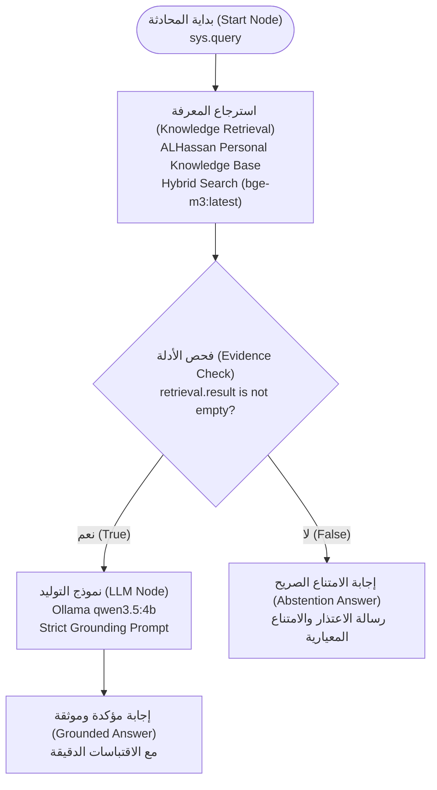

# معمارية ومخطط تطبيق مسار المحادثة المرئي (Chatflow Architecture)
# ALHassan AI — Personal Knowledge Assistant Chatflow Specification

- **اسم التطبيق (Application Name):** `ALHassan AI — Personal Knowledge Assistant`
- **معرف التطبيق (App ID):** `a517d042-df7a-4fc0-a1ac-70ffb44236c5`
- **نوع التطبيق (Mode):** `advanced-chat` (Visual DAG Chatflow)
- **معرف سير العمل المنشور (Workflow ID):** `760383a9-f94a-42f1-b3ac-cfa920b39e39` (الإصدار v1.0.0)
- **معرف قاعدة المعرفة المرتبطة:** `c58ff9a4-0017-4ebf-9aec-e1d8ff48744f` (`ALHassan Personal Knowledge Base`)
- **رابط الاستوديو التفاعلي (Studio URL):** [Dify Workflow Studio](http://127.0.0.1/app/a517d042-df7a-4fc0-a1ac-70ffb44236c5/workflow)
- **مسار ملف DSL المصدر:** [alhassan_ai_chatflow.yml](file:///c:/Users/alhassanalshami/local-rag/workflows/alhassan_ai_chatflow.yml)

---

## 1. مخطط تدفق البيانات والعقد (Visual Node Graph DAG)

تم بناء مسار التدفق المرئي باستخدام رسم بياني موجه غير حلقي (DAG) صارم، يضمن فحص الأدلة قبل إرسال السياق إلى نموذج التوليد، مع مسار إلزامي للامتناع الصريح في حال عدم كفاية أو انعدام الأدلة:



---

## 2. تفاصيل وتكوين العقد البرمجية (Node Specifications)

### 1. عقدة البداية (`start`)
- **المعرف:** `start`
- **النوع:** `start`
- **الموضع:** `x: 80, y: 282`
- **المهمة:** استقبال استعلام المستخدم وسياق الجلسة عبر المتغير `{{#sys.query#}}`.

### 2. عقدة استرجاع المعرفة (`retrieval`)
- **المعرف:** `retrieval`
- **النوع:** `knowledge-retrieval`
- **الموضع:** `x: 380, y: 282`
- **قواعد المعرفة المرتبطة:** حصراً `c58ff9a4-0017-4ebf-9aec-e1d8ff48744f` (`ALHassan Personal Knowledge Base`).
- **وضع الاسترجاع:** `single` مع نموذج استعلام `qwen3.5:4b`.
- **معايير البحث الهجين:**
  - `top_k`: 5 مقاطع سياقية.
  - خوارزمية البحث: Hybrid Search (Vector Embeddings عبر `bge-m3:latest` + Sparse Keyword BM25).
  - إعادة الترتيب: معطلة لتفادي زمن التأخير غير الضروري.

### 3. عقدة فحص الأدلة والتحقق الشرطي (`evidence_check`)
- **المعرف:** `evidence_check`
- **النوع:** `if-else`
- **الموضع:** `x: 680, y: 282`
- **المنطق الشرطي:**
  - التحقق من أن ناتج الاسترجاع `{{#retrieval.result#}}` ليس فارغاً (`not empty`).
  - في حال توفر أدلة مسترجعة: الانتقال إلى عقدة `llm`.
  - في حال انعدام الأدلة: الانتقال فوراً وبشكل حتمي إلى عقدة `answer_abstain` دون استدعاء نموذج التوليد.

### 4. عقدة النموذج اللغوي والتوليد المقيد (`llm`)
- **المعرف:** `llm`
- **النوع:** `llm`
- **الموضع:** `x: 980, y: 180`
- **النموذج المحلي:** `qwen3.5:4b` عبر Ollama Native (`langgenius/ollama/ollama`).
- **المعلمات:**
  - `temperature`: 0.1 (درجة حرارة منخفضة جداً لمنع الابتكار الخيالي وضمان الالتزام الصارم بالحقائق).
  - `max_tokens`: 768 رمزاً.
  - `top_p`: 0.9.
  - `think`: False (تعطيل سلاسل التفكير غير الضرورية لتسريع الاستجابة).
- **السياق المضمن:** `{{#retrieval.result#}}`.
- **تعليمات النظام (System Prompt):** موجه تأريض صارم متعدد اللغات، يفرض منع التخمين، وحظر إفشاء البيانات المحجوبة، وإلزامية الاقتباسات المرجعية.

### 5. عقدة الإجابة الموثقة (`answer_grounded`)
- **المعرف:** `answer_grounded`
- **النوع:** `answer`
- **الموضع:** `x: 1280, y: 180`
- **النص المخرج:** `{{#llm.text#}}` متضمناً الحقائق الموثقة والأقسام المقتبس منها.

### 6. عقدة الامتناع الصريح (`answer_abstain`)
- **المعرف:** `answer_abstain`
- **النوع:** `answer`
- **الموضع:** `x: 980, y: 420`
- **النص المخرج الإلزامي:**
  ```text
  لا تتوفر لدي معلومات موثقة عن هذا الموضوع ضمن قاعدة المعرفة الحالية الخاصة بالحسن بليغ الشامي.

  The requested information is not available in the verified knowledge base of ALHassan Baligh ALShami.
  ```

---

## 3. العزل والتحصين ضد التداخل (Logical Isolation Assurance)

1. **انعدام الارتباط بتطبيقات جيب السابقة:**
   - تطبيق `ALHassan AI — Personal Knowledge Assistant` مسجل كمعرف تطبيق جديد كلياً (`a517d042...`).
   - لا يشترك هذا التطبيق في أي حواف (Edges) أو عقد مع تطبيقات محفظة جيب السابقة (`Local Bilingual RAG Assistant` أو `Local Bilingual RAG Chatflow`).
2. **انعدام تداخل قواعد البيانات:**
   - العقدة `retrieval` تستعلم حصراً من `c58ff9a4-0017-4ebf-9aec-e1d8ff48744f`.
   - لا يمكن لتطبيق الحسن الشامي استرجاع أي فقرة من وثائق المحفظة أو العكس.
3. **أمان واجهة البرمجة (API Token Security):**
   - تم إنشاء مفتاح وصول برمجي خاص بالتطبيق من النوع `app-...`.
   - الصلاحيات مقيدة حصراً بهذا التطبيق دون أدنى صلاحيات إدارية على مستوى المنصة أو بقية التطبيقات.

