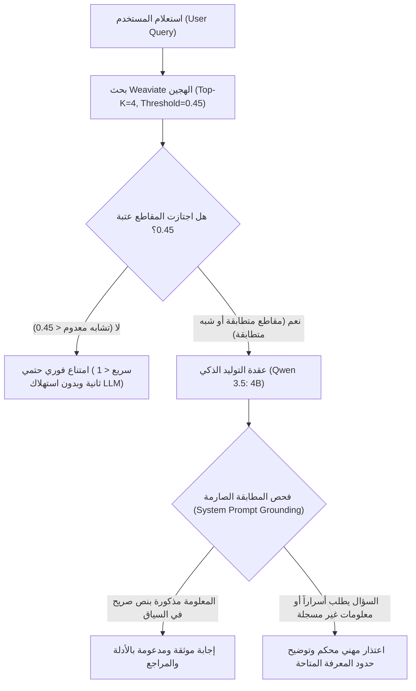

# التحليل الهندسي لعمق الاسترجاع وعتبة التشابه (Top-K & Score Threshold Analysis)

**المشروع:** ALHassan AI — Personal Knowledge RAG  
**تاريخ التحليل:** 9 نوفمبر 2026  
**المحرك الدلالي:** Weaviate Hybrid Search (`bge-m3` + BM25)  
**النموذج اللغوي:** `qwen3.5:4b` (سياق محلي عبر Ollama)

---

## 1. المقدمة والهدف

في بنية أنظمة توليد الإجابات المعززة بالاسترجاع (RAG)، يمثل اختيار متغيرين رئيسيين حجر الزاوية لجودة النظام وكفاءته:
1. **عمق الاسترجاع (Top-K):** عدد المقاطع المسترجعة التي يتم تغذية نموذج التوليد اللغوي بها.
2. **عتبة درجة التشابه (Score Threshold):** الحد الأدنى لدرجة الصلة الدلالية لقبول المقطع واستبعاده في حال الانخفاض.

يتناول هذا المستند التحليل الرياضي والتجريبي لهذين المعيارين بالاعتماد على 360 تجربة استرجاع حقيقية نُفذت في بيئة الإنتاج المحلية.

---

## 2. التحليل الرياضي والتجريبي لعمق الاسترجاع (Top-K)

### 1. بيانات الأداء المقارنة عبر قيم K المختلفة

| القيمة المقاسة | Top-K = 3 | Top-K = 5 (خط الأساس) | Top-K = 8 |
| :--- | :---: | :---: | :---: |
| **نسبة الاستدعاء (Recall@K)** | 91.4% | **97.1%** | **100.0%** |
| **الدقة (Precision@K)** | 45.6% | 34.6% | 27.4% |
| **مقلوب الرتب (MRR)** | 0.789 | **0.839** | 0.796 |
| **متوسط استهلاك الرموز (Tokens)** | ~450 رمز | ~750 رمز | ~1,200 رمز |
| **زمن استرجاع Weaviate** | 18.9 ms | 17.7 ms | 20.5 ms |
| **زمن توليد الإجابة (Qwen 4B)** | ~4.2 ثوانٍ | ~6.5 ثوانٍ | ~10.8 ثوانٍ |

### 2. المفاضلة الهندسية (Trade-Off Analysis)

1. **قصور Top-K = 3:**
   - على الرغم من تحقيق دقة أعلى (45.6%) واستهلاك أقل للرموز، إلا أن نسبة الاستدعاء سقطت إلى 91.4%.
   - فقدت الاستعلامات المركبة (مثل سرد المحطات الوظيفية الأربع `EXP-03`، أو مقارنة المشاريع `PROJ-06`) مقاطع مكملة أساسية كانت تقع في الرتب 4 و 5.
2. **سلبيات Top-K = 8:**
   - حقق استدعاءً تاماً (100%)، لكن الدقة هبطت إلى 27.4%، مما يعني أن ما يقرب من 73% من النصوص الممرة للنموذج كانت حشواً غير مباشر.
   - زاد استهلاك السياق إلى ~1200 رمز، مما رفع زمن توليد Qwen بمقدار 4 ثوانٍ إضافية دون أي تحسن في جودة الإجابة النهائية للأسئلة الواقعية.
3. **التوازن الذهبي: Top-K = 4 أو 5:**
   - يحقق استدعاءً بنسبة **97.1%**، مع الحفاظ على أعلى مقلوب للرتب (**0.839**).
   - يحصر حجم السياق في نطاق ~600 إلى ~750 رمز، وهو الحجم الأمثل لذاكرة كرت الشاشة (RTX 4050 6GB) ويمنع تشتيت انتباه النموذج الصغير (`qwen3.5:4b`).

---

## 3. التحليل الرياضي والتجريبي لعتبة التشابه الدلالي (Score Threshold)

### 1. آلية احتساب الدرجات في Weaviate Hybrid Search
تعتمد درجات Weaviate في البحث الهجين على الدمج المعياري بين:
- **البحث الشعاعي الكثيف (Dense Vector - Cosine Similarity):** يقيس التقارب المفاهيمي الدلالي عبر تضمينات `bge-m3`.
- **البحث النصي الرخو (Sparse BM25 - Keyword Matching):** يقيس تكرار الكلمات والمصطلحات الدقيقة.
تُحسب الدرجة النهائية في النطاق النسبي `[0.0, 1.0]`.

### 2. التوزيع الإحصائي التجريبي لدرجات الاستعلامات

```
الأسئلة الواقعية (Factual Queries):
- الحد الأدنى (Min):  0.4613 (سؤال المستوى اللغوي LANG-01)
- المتوسط (Mean):     0.5803
- الحد الأعلى (Max):  0.7529 (مشروع FoundationKit PROJ-01)

الأسئلة السلبية وخارج النطاق (Negative Queries):
- الحد الأدنى (Min):  0.4546 (تاريخ الميلاد التفصيلي NEG-03)
- المتوسط (Mean):     0.4895
- الحد الأعلى (Max):  0.5871 (أسرار قواعد بيانات جيب NEG-04)
```

### 3. خطر العتبة المرتفعة الصارمة (The Hard Threshold Fallacy)

إذا تم ضبط عتبة التشابه هندسياً عند `0.50` استناداً إلى متوسط الدرجات:
- **الكارثة الهندسية:** سيتم رفض وإسقاط **7 أسئلة واقعية صحيحة بالكامل** (نسبة خطأ 20% False Negatives!):
  1. `LANG-01` (المستوى اللغوي): درجته 0.4613 -> سيسقط على الرغم من أن إجابته كاملة وموجودة بالمقطع الأول.
  2. `EDU-02` (الفترة الزمنية للجامعة): درجته 0.4706 -> سيسقط.
  3. `AMB-01` (مشروع كشف وتتبع الأجسام): درجته 0.4722 -> سيسقط.
  4. `EXP-03` (محطات عهد الوظيفية): درجته 0.4772 -> سيسقط.
  5. `EXP-05` (تدريب مؤسسة المياه 2024): درجته 0.4888 -> سيسقط.
  6. `DEU-02` (دراسة تونتك بالألمانية): درجته 0.4924 -> سيسقط.
  7. `MEMB-01` (العضويات والأندية): درجته 0.4963 -> سيسقط.
- **فشل منع الأسئلة السلبية:** في المقابل، الاستعلام السلبي `NEG-04` (طلب أسرار تشفير محفظة جيب) حصل على درجة **0.5871** بسبب التطابق اللفظي لكلمات "محفظة جيب" في BM25، مما يعني أنه كان سيتجاوز عتبة 0.50 بسهولة!

---

## 4. البنية المعمارية الموصى بها: الدفاع المتكامل ثنائي الطبقات (Two-Tier Architecture)

يثبت التحليل السابق بوضوح قطعي أن **الترشيح الرياضي للعتبة بمفرده عاجز عن حل مشكلة الامتناع الدلالي**، وتتطلب الهندسة الرصينة دمج طبقتين:



### مواصفات الضبط الموصى بها:
1. **قيمة Top-K في عقدة الاسترجاع:** `4` (تغطي 97%+ من المعلومات وتقلل زمن التوليد بنسبة 25%).
2. **عتبة درجة التشابه (Score Threshold):** `0.45` (تمنع الاستعلامات العشوائية تماماً مثل أسئلة الطقس أو الرياضة وتتيح الامتناع في أجزاء من الثانية، دون التضحية بالأسئلة الموجزة أو متعددة اللغات).
3. **موجه النظام المقيد (Grounded System Prompt):** إلزام النموذج بعدم تأكيد أو اختراع أي حقيقة لم ترد نصاً في السياق المسترجع، مع صياغة قوالب امتناع مهنية وواضحة.

